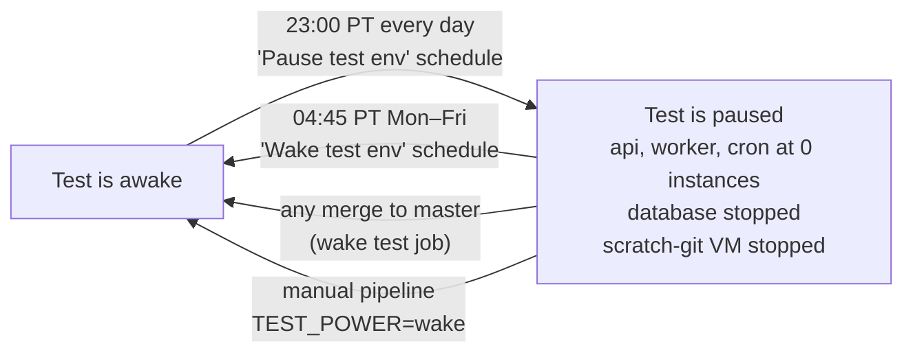

# Pause the test environment overnight and on weekends

- **Created:** 2026-11-16
- **Author:** Chris Hoefgen
- **Linear:** [DEV-12906](https://linear.app/whalesync/issue/DEV-12906) (label _Infra_)
- **Status:** The script and the CI jobs are written. The two schedules haven't been created yet, so test still runs
  around the clock.
- **Related:**
  - Whalesync shipped the same thing for `wsv1-test` the same day: [DEV-12904](https://linear.app/whalesync/issue/DEV-12904),
    `tools/ops/test_power.sh` and `docs/plans/2026-11-16-pause-test-overnight.md` in the whalesync repo. This plan
    copies its design.
  - [Scratch hosting cost review](../dev-11808-scratch-hosting-cost-review.md)
  - [Maintenance mode plan](2026-09-17-maintenance-mode-plan.md), whose Cloud Run quiesce this reuses

## Problem

Scratch's test environment runs around the clock, but people only use it during the working day. Nothing deploys to
it or tests against it between about 18:00 and 07:30 PT on weekdays, or on most of the weekend, yet it bills the same
as at noon. If nobody is working or merging, test doesn't need to be up.

## GCP environment involved

| Environment | Project | Region | Hosts |
| --- | --- | --- | --- |
| Test | `spv1eu-test` | `europe-west1` | `test.scratch.md`, `test-api.scratch.md` |

Production (`spv1eu-production`) is not touched. The script hardcodes the test project.

## Summary



- A new script, `terraform/tools/test_power.sh status | wake | pause`, pauses and wakes test.
- A GitLab schedule pauses test at 23:00 PT every day, and another wakes it at 04:45 PT on weekdays, so test is up
  when Curtis starts at 8 am ET.
- Every master pipeline wakes test before it migrates, deploys, or tests (`wake test`). That wake changes nothing
  when test is already up. A merge on a weekend or at night wakes test until the next 23:00 pause.
- Anyone can wake or pause test by hand with a manual pipeline on `master`.

This saves about **$78/mo**, about a quarter of test's bill.

## Cost and saving

Test's run-rate from the billing export, Nov 1–14 scaled to a month ([query](#appendix-reproducing-the-numbers)):
**about $325/mo** ($10.70/day, flat every day). That's half of August's $651, after the right-sizing in the cost
review.

| Item | $/mo | Pauses? |
| --- | ---: | --- |
| Cloud Run `worker-service` (instance-billed, CPU always on, min 1) | 57 | Yes |
| Cloud Run `cron-service` (instance-billed, CPU always on, min 1) | 54 | Yes |
| Cloud SQL `eu-test-postgres-7442e8bc`: vCPU and RAM | 51 | Yes. Its storage (~$2) keeps billing |
| scratch-git VM (`e2-medium`): core and RAM | 27 | Yes. Its disks keep billing |
| Redis (Basic, 1 GB) | 37 | No: Memorystore can't be stopped |
| Load balancer forwarding rules | 44 | No |
| `cloudsql-proxy` bastion VM (`e2-small`) | 13 | No, see [Key decisions](#key-decisions) |
| NAT, Cloud Armor, secrets, disks, storage, and the rest | ~34 | No |
| Cloud Run `api-service` and `client-service` (request-billed) | 8 | Already scale to 0 on their own |
| **Total** | **≈325** | |

- **Paused time.** The last five weeks of master merges (90 push pipelines, 2026-10-12 to 11-15) were replayed against
  the schedule: pause at 23:00 PT, wake at the first merge or at 04:45 PT on a weekday. Test would have been paused
  about **70 hours a week, or 41%**.
  - With no merges at all, the pause would run 77 hours a week: 5¾ hours on each weeknight, and Friday 23:00 to Monday
    04:45.
  - Only 2 merges landed between 23:00 and 05:00 PT (both around 04:15), and 4 landed on weekends.
- **Saving.** 41% of the $189/mo that pauses:

  | Paused | Saving/mo |
  | --- | ---: |
  | worker and cron | ~$46 |
  | Cloud SQL | ~$21 |
  | scratch-git VM | ~$11 |
  | **Total** | **≈ $78 (about 24% of test, ~$940/yr)** |

## What pauses and what doesn't

- **Pauses:**
  - `api-service`, `worker-service`, and `cron-service`, with service-level manual scaling at 0
    (`gcloud run services update <service> --scaling=0`; `--scaling=auto` wakes them).
    - This creates no revision, and Terraform already ignores the service-level `scaling` block on all three
      (`terraform/modules/env/services.tf`), so it causes no drift.
    - At 0, new requests get "Service unavailable" instead of starting an instance.
  - The primary Cloud SQL instance, with activation policy `NEVER` (`ALWAYS` starts it). Its private IP and storage
    stay.
  - The scratch-git VM, with `gcloud compute instances stop`. Its data disk, boot disk, and reserved internal IP stay.
    Its startup script runs again when it boots.
- **Keeps running:**
  - `client-service`. It's request-billed and already scales to 0, and Terraform doesn't ignore its `scaling` block, so
    pausing it would save nothing and drift. `test.scratch.md` still loads, but its API calls fail.
  - Redis, the `cloudsql-proxy` bastion, the load balancers, NAT, and Cloud Armor.

## Design

### The script

`terraform/tools/test_power.sh` lives next to `maintenance_mode.sh` and borrows its helpers, but it's a separate
script so the production maintenance tool doesn't change. It runs on macOS's bash 3.2 and in `unawareguitar/gcp-dind`,
and every gcloud call passes `--project` and `--billing-project` set to `spv1eu-test`.

**`pause`:**

1. Refuse if the gcloud account is a read-only one (`*-readonly@`), or if test is in maintenance mode.
2. Post to Slack, then snooze the alerts a pause trips (see [Alerts](#alerts)).
3. Scale `cron-service` and `api-service` to 0, the services that add work. Then scale `worker-service` to 0. If
   any of these fails, stop there and leave scratch-git and the database running.
4. Wait 60 s so a scratch-git request the worker started can finish.
5. Stop the scratch-git VM and the database, in parallel.
6. Post ":zzz: Test is paused".

**`wake`:**

1. If nothing is paused, change nothing and post nothing, but end any snooze left over. Nothing is paused when no
   service is at manual scaling, the database's activation policy is `ALWAYS`, and the VM is `RUNNING`. Anything the
   script can't read counts as paused. This keeps the wake in every master pipeline quiet and fast (about 15 s).
2. Refuse for a read-only account or during maintenance mode, as for `pause`.
3. Post to Slack, then start the database and the VM in parallel.
4. If the VM booted in the last 30 minutes, including just now, wait for its startup script to finish with exit
   status 0 (see [The scratch-git boot](#the-scratch-git-boot)). Then wait for the internal load balancer to report
   scratch-git `HEALTHY`.
5. Set `api-service` and `worker-service` to automatic scaling. Wait 45 s, then do the same for `cron-service`. This is
   `maintenance_mode.sh`'s resume order: the worker exists before the cron's scheduler and reapers run.
6. Wait for `https://test-api.scratch.md/health` to return 200. api exits at boot when Postgres is unreachable
   (`server/src/db/db.service.ts`), so a 200 also means the database is back.
7. End the snooze, then post ":sunny: Test is awake".

A full wake takes about 6 to 9 minutes. In a master pipeline it runs alongside the build jobs, so the deploy stage
rarely waits for it.

**`status`** shows each service's scaling, the database's activation policy and state, the VM's status, scratch-git's
health behind its load balancer, whether the alerts are snoozed, and the maintenance lockdown. It's read-only, so
developers' read-only accounts can run it.

### The scratch-git boot

The VM has never been stopped since it was created (2026-09-18), so a pause makes its boot path a daily one.

- **The startup script runs on every boot** (`terraform/modules/scratch_git_gce/scripts/startup.sh`). It mounts the
  data disk, reads two secrets, prunes Docker, pulls `spinner-scratch-git:latest` and `nginx:alpine`, and recreates the
  blue, green, and proxy containers. Its copy in the VM's metadata matches the repo, byte for byte, as of 2026-11-16.
- **The mount race.** The data disk isn't in `/etc/fstab`, and the containers run with `--restart unless-stopped`.
  On boot, Docker can restart the old blue and green containers before the startup script has mounted the data disk.
  They then run against the empty mount point on the boot disk until the script recreates them.
  - This is harmless because nothing calls scratch-git until the wake has seen the startup script finish.
  - It does leave a little junk under the mount point on the boot disk.
  - A follow-up could have Docker wait for the mount.
- **How the wake knows the script finished.** The guest agent logs "Finished running startup scripts" and
  "startup-script exit status N". The wake polls two places and takes whichever answers first:
  - the serial console, counting only lines stamped at or after the start;
  - Cloud Logging (`GCEMetadataScripts`, or `syslog` through the ops agent).

  - **The latest exit status counts.** A non-zero one fails the wake, and the services stay paused. If neither source
    shows a finish within 12 minutes, the wake warns and relies on the load balancer's health check. The first manual
    wake confirms which source answers.
  - **The check also runs on any VM that booted in the last 30 minutes**, even one this run didn't start. Otherwise a
    retry after a failed startup script would find the VM running, see the proxy report healthy, and wake the services
    against containers that may not be using the data disk. Each retry fails the same way until someone fixes the cause
    and runs a pause and a wake to boot the VM again.
- **Each boot posts two scratch-git startup messages** to Slack, one from each container.
- **The master pipeline's scratch-git deploy** (`deploy scratch-git to test environment`) runs in the deploy stage,
  after `wake test` has waited for the startup script. So the two never overlap.

### Alerts

Test's alerts are on, and they email the team (`team@whalesync.com`; test has no Slack alert channel). Before it
changes anything, a pause creates one Cloud Monitoring snooze named "Test is paused", for 7 days, on these policies:

| Policy | Why a pause trips it |
| --- | --- |
| Scratch Eu-Test API Service - 5xx Errors | Requests to a service at 0 get 503s |
| Scratch Eu-Test Client Service - 5xx Errors | The same, for the client's calls to the API |
| Scratch Eu-Test Cron Service - 5xx Errors | The same |
| Scratch Eu-Test Scratch Git Memory > 85% | Its "memory metric missing" condition fires once the VM stops |
| Scratch Eu-Test Scratch Git Ops Agent unresponsive | It can fire while the agent starts after a boot |
| Scratch Eu-Test Scratch Git CPU > 90% | The image pulls at boot can trip it |

- The database alerts are all threshold conditions, so a stopped database fires none of them.
- A wake ends the snooze, even when nothing else needed waking. A snooze that never ends runs out by itself after 7
  days, long enough for a holiday weekend.
- A failure to snooze, or to end a snooze, only warns.

### Slack

The script posts when a wake or a pause starts, when it finishes (with how long it took), and when it fails partway.
It uses the `SLACK_NOTIFICATION_WEBHOOK_URL` secret in `spv1eu-test`, the same webhook `maintenance_mode.sh` uses.
The URL is passed to curl on stdin and never printed. A wake that changes nothing posts nothing.

### Maintenance mode

Both `wake` and `pause` refuse while test's maintenance lockdown is on: Cloud Armor rule 1000 of `eu-test-maintenance`
reads `deny(502)`. Otherwise a wake would start the backends that maintenance mode stopped, and a pause would stop the
database under whatever the window is for. A preview window blocks nothing, so it doesn't count. During a test
maintenance window, the 23:00 pause and every master pipeline's wake fail loudly, which also holds deploys, as the
maintenance runbook asks.

### CI

The jobs are in `gitlab-ci/test-power.yml`:

- **`wake test`** (`gitlab-ci/stages/01-build-and-test.yml`) runs in the build and test stage with `needs: []`, in:
  - every master pipeline that deploys test (the `on_merge_to_master` rule);
  - every "Scheduled CLI Tests" run. `cli integration tests` lists it in `needs:`, because the two share a stage.

  The test migrations, deploys, and post-deploy environment tests have no `needs:`, so they wait for the whole stage,
  wake included. Each has a comment saying a future `needs:` must list `wake test`.
- **The manual and scheduled pipelines.** On `master`, `TEST_POWER=wake` runs only `wake test now`, and
  `TEST_POWER=pause` runs only `pause test now`. `.gitlab-ci.yml` leaves out every stage file, every release file, and
  secret detection whenever `TEST_POWER` is set. A mistyped value, or the variable on any other branch, matches no job,
  so GitLab creates no pipeline.
- **The jobs:**
  - run as `gitlab-service-account@spv1eu-test` (`.gcp_eu_test_env`). It already has `run.developer`,
    `cloudsql.editor`, `compute.instanceAdmin.v1`, `monitoring.admin`, `logging.admin`, and `secretmanager.admin`;
  - use `unawareguitar/gcp-dind` (`.docker_builder_image`), whose gcloud 586 has `run services update --scaling`;
  - share `resource_group: test-power`, so a wake and a pause never overlap;
  - aren't interruptible, retry twice, and time out after 30 minutes.

### Schedules

GitLab schedules live outside the repo (Build > Pipeline schedules):

| Schedule | Cron (America/Los_Angeles) | Branch | Variables |
| --- | --- | --- | --- |
| Pause test env | `0 23 * * *` | `master` | `TEST_POWER=pause` |
| Wake test env | `45 4 * * 1-5` | `master` | `TEST_POWER=wake` |

There's no weekend wake. A merge on a weekend wakes test until 23:00. Nothing else that's scheduled conflicts:

- CLI Integration Tests run at 07:30, 11:30, and 17:30 on weekdays, and wake test themselves anyway.
- Test Releases (12:00), Cleanup Github Releases (08:00), and Auto push to prod (08:00) don't touch test.

## Operations

```bash
# Anyone, including the read-only accounts: what's paused right now?
terraform/tools/test_power.sh status
```

```
api-service                    PAUSED (manual, 0 instances), revision api-service-01989-7tn
worker-service                 PAUSED (manual, 0 instances), revision worker-service-01412-sj9
cron-service                   PAUSED (manual, 0 instances), revision cron-service-01569-w6h
eu-test-postgres-7442e8bc      PAUSED (stopped), state STOPPED
scratch-git                    PAUSED (TERMINATED)
scratch-git-backend-service    UNHEALTHY
alerts                         snoozed ("Test is paused")
maintenance lockdown           OFF
```

**Wake test at night:** Build > Pipelines > Run pipeline, on `master`, with `TEST_POWER` = `wake`. It takes about 6
to 9 minutes. Do this first when you need test outside working hours: to use `test.scratch.md`, deploy an MR to test
by hand, run `connect_to_gcp_db_readonly.sh test`, SSH to scratch-git, or apply Terraform to test.

**Pause test by hand:** the same, with `TEST_POWER` = `pause`.

**Stop pausing test:** set the "Pause test env" schedule inactive, then run the manual wake.

**A wake failed.** The Slack post and the job log say which step failed.

- **The startup script failed.** Read its output with
  `gcloud compute instances get-serial-port-output scratch-git --zone=europe-west1-b --project=spv1eu-test`, or in
  Cloud Logging. A stop and start (a pause and a wake) reruns it.
- **The VM didn't start** (for example, `ZONE_RESOURCE_POOL_EXHAUSTED`). The job retries; run the wake again later.
- **The API didn't come up.** Check that the database is `RUNNABLE` (`status`), then the api-service logs.

## Risks and accepted gaps

- **No in-use check before a pause.** A merge around 23:00 can have its deploy or tests fail when the pause lands.
  The next merge deploys again. There were no merges between 23:00 and 04:00 PT in the last 5 weeks.
- **Working at night.** `test-api.scratch.md` returns "Service unavailable" while test is paused. Anyone working at
  night runs the manual wake.
- **Terraform.** While test is paused, a plan should show the database's `activation_policy` going `NEVER → ALWAYS`.
  That's the provider default, and the first paused plan confirms it. An apply would start the database but not the
  services or the VM, so wake test before applying to it at night.
  - `activation_policy` isn't added to `ignore_changes`, because the cloudsql module is shared with production, and
    ignoring it there could hide a stopped production database.
  - The VM has no `desired_status`, so Terraform doesn't start it.
- **Crons.** They run on `cron-service`, on UTC.
  - `old-job-cleanup` (03:00 UTC) and `rehosted-asset-reaper` (04:00 UTC) still run on weeknights (19:00 and 20:00 PT),
    but miss weekend nights.
  - `subscription-enforcement` looks back 12 hours, so a lapse during a weekend pause is skipped.
  - User schedules that came due while paused fire once at the wake.
  - A routine paused mid-step fails on its step timeout.

  This is all acceptable for test.
- **Backups.** Cloud SQL's daily backup (03:00 UTC) is skipped on Saturday and Sunday evenings PT. The scratch-git
  snapshot schedule (05:00 and 17:00 UTC) keeps running on the stopped VM's disk.
- **Service-level min and max.** `--scaling=0` deletes a service's service-level min and max, and `--scaling=auto`
  doesn't restore them. On 2026-11-16 all three services had a service-level max of 20. That's dropped by the first
  pause, but each revision's own max (1) still applies.
- **Whalesync calls Scratch test.** Whalesync's test environment uses `test-api.scratch.md` for Live Export and
  shadow users, and it pauses on its own schedule.
  - On weekends, a Whalesync merge can wake their test while ours stays paused, so those calls get 503s until a Scratch
    merge or a manual wake.
  - Weekday mornings line up: Scratch wakes at 04:45 PT, and Whalesync's e2e run is at 05:00.
- **The scratch-git boot** is now a daily path. See [The scratch-git boot](#the-scratch-git-boot) for the mount race,
  the Docker Hub pull, and the extra Slack posts.
- **A pause cuts in-flight work.** A BullMQ job running on the worker stalls and is retried after the wake. scratch-git
  gets 60 s to finish a request before its VM stops, and the VM's shutdown stops its containers gracefully.

## Rollout

| Step | Summary | Status |
| --- | --- | --- |
| MR | `test_power.sh`, the CI jobs, and this doc | Drafted |
| Manual trial | One evening, a manual pause, then a manual wake | Planned, after merge |
| Schedules | Create "Pause test env" and "Wake test env" | Planned, after the trial |
| Bake | Two weeks; confirm the saving, then move this doc to `resolved/` | Planned |

1. Merge the MR. The manual pipelines run the script from `master`, so they work right away.
2. One evening, run the manual pause pipeline. Check:
   - the Slack posts;
   - `test_power.sh status`;
   - after 15 minutes, which alert emails arrived, and that the snooze covered them.
3. Run the manual wake pipeline. Check:
   - how long it took, and which source reported the startup script finishing (the job log says);
   - that scratch-git's data is intact, for example with a CLI pull of an existing workspace, or `sudo gitops-disk`
     through `connect_to_git_service_ssh.sh test`;
   - that the snooze has ended.

   Then confirm that the next master pipeline's `wake test` changes nothing.
4. While test is paused, someone with plan rights runs `terraform plan` in `terraform/envs/eu-test`. It should show
   only the database's `activation_policy`.
5. Create both schedules. Watch the first few mornings: the 04:45 wake, the 07:30 CLI tests, and Curtis's start.
6. After two weeks, rerun the [billing query](#appendix-reproducing-the-numbers) and compare.

Each hand-run step against test needs Chris's go-ahead.

## Rollback

Set the "Pause test env" schedule inactive, then run the manual wake. `wake test` still runs in every master
pipeline, and changes nothing on an awake test. To remove it entirely, revert the MR.

## Testing

- `shellcheck` passes on the script.
- **A fake `gcloud`, `curl`, and `sleep`** ran the script under bash 3.2 (macOS) and bash 5.2 with busybox `awk`
  and `date` (in `unawareguitar/gcp-dind`): 181 checks, all passing.
  - `status` on an awake and on a paused test.
  - **Waking an awake test** makes no updates and no posts, and doesn't read the Slack secret. A leftover snooze still
    ends; an expired one is left alone.
  - **One paused or unreadable resource** (a service, the database, or the VM) runs the full wake.
  - **Full wake order:** the database and VM start; the startup script finishes; scratch-git is healthy; api and worker
    wake; the 45 s settle; cron wakes; `/health` returns 200; the snooze ends.
  - **Startup-script signal:**
    - The serial console and Cloud Logging each work on their own.
    - Lines from an earlier boot, or in a non-ISO format, never count.
    - The script's own output is never printed.
    - A failed run followed by a successful re-run counts as a success.
    - A VM that is already running but booted recently is still checked, so a retry after a failed startup script
      fails too.
    - A VM that booted long ago isn't checked.
  - **Wake failures:**
    - A startup script with a non-zero exit, a scratch-git that never turns healthy, a VM that won't start, or an API
      that never returns 200 each fail the wake, leave the services paused, and post the failure.
    - With no logged finish, the wake falls back to the health check.
  - **Pause order:** the snooze comes before the first change; then cron and api; then worker; the 60 s drain; then
    the VM and the database.
  - **Pause failures:**
    - A failed cron, api, or worker update stops the pause before the VM and the database.
    - A failed database stop still reports.
    - A missing alert policy, a failed snooze, an unreadable Slack secret, or a failed Slack post only warns.
  - **Guards:** maintenance mode (but not a preview), a read-only account, a gcloud without `--scaling`, and two
    primary databases each refuse.
  - **Safety:** every call names `spv1eu-test` as its project and billing project, the webhook URL is never printed,
    and `client-service` is never touched.
- **Live, read-only:** `test_power.sh status` against `spv1eu-test` on 2026-11-16 read every resource correctly. All
  six snoozed policy names exist in test.
- **The CI image:** `unawareguitar/gcp-dind` (gcloud 586) has every subcommand and flag the script uses.
- **GitLab CI**, simulated with `gitlab-ci-local` against the config before and after the change:
  - a push to `master` (and a manual pipeline with no `TEST_POWER`) gains only `wake test`;
  - `TEST_POWER=wake` or `pause` on `master`, from a schedule or by hand, gets only `wake test now` or `pause test now`;
  - `TEST_POWER` on another branch, or a mistyped value, gets no jobs;
  - "Scheduled CLI Tests" gains `wake test`, with `cli integration tests` needing it;
  - these are unchanged: "Hourly Test Releases", "Auto push to prod", "Cleanup Releases", "Desktop and CLI Releases"
    on `prod`, a push to `prod`, merge request pipelines, and `RELEASE_CLI_ONLY`;
  - the dependency chains validate.
- **Not run yet:** a real pause and wake against test ([Rollout](#rollout) steps 2 and 3).

## Key decisions

- **Pause Cloud Run, the database, and the scratch-git VM.** Chris's call (2026-11-16).
  - Cloud Run alone would save about $46/mo, and adding the database about $67. All three save about $78.
  - Whalesync keeps its main test database running. Scratch stops its own, because the migrations job runs in the
    deploy pipeline after `wake test`, so nothing that needs the database runs before a wake.
- **Keep the bastion running.** At about $13/mo it would save about $5. Migrations and the read-only database scripts
  tunnel through it, Terraform sets it to `RUNNING`, and it runs `apt upgrade` on every boot.
- **A timer, not on demand.** People use test all day, with no pipeline to tell when they're done, so it pauses at a
  fixed time.
- **Wake at 04:45 PT on weekdays.** That's about six hours after the pause, and it's up before Curtis starts at 8 am ET.
- **No in-use check before a pause.** The same as Whalesync: a late merge's deploy fails, and the next merge fixes it.
- **Snooze the alerts while paused**, rather than turning them off in test and losing them during the day.
- **A separate script.** `maintenance_mode.sh` is the production maintenance tool, so `test_power.sh` copies the few
  helpers it needs instead of refactoring it.

## Follow-ups

- Fold `cron-service` into `worker-service` in test ([cost review](../dev-11808-scratch-hosting-cost-review.md) #5).
  It's the same image, and it would save about $54/mo around the clock, more than this pause saves on Cloud Run.
- Have Docker on the scratch-git VM wait for the data disk to mount (`/etc/fstab`, or `RequiresMountsFor` on
  `docker.service`), so a boot never starts the containers against the empty mount point. It needs the out-of-band
  startup-script rollout, because Terraform ignores changes to the VM's startup script.

## Appendix: reproducing the numbers

All read-only.

**Test's cost by resource and SKU** (the billing export Whalesync's plan also uses):

```bash
CLOUDSDK_BILLING_QUOTA_PROJECT=playground-419323 bq --project_id=playground-419323 query --use_legacy_sql=false '
SELECT service.description AS service, REGEXP_EXTRACT(resource.name, r"[^/]+$") AS resource, sku.description AS sku,
  ROUND((SUM(cost) + SUM(IFNULL((SELECT SUM(c.amount) FROM UNNEST(credits) c), 0))) / 14 * 30.4, 2) AS monthly
FROM `playground-419323.all_billing_data.gcp_billing_export_resource_v1_0127FE_D0EBC4_4B91B8`
WHERE project.id = "spv1eu-test"
  AND usage_start_time >= TIMESTAMP("2026-11-01") AND usage_start_time < TIMESTAMP("2026-11-15")
GROUP BY 1, 2, 3 HAVING monthly >= 0.5 ORDER BY monthly DESC'
```

**Master merge times**, for the paused-time replay:

```bash
glab api "projects/whalesync%2Fspinner/pipelines?ref=master&source=push&per_page=100&updated_after=2026-10-12T00:00:00Z"
```

The replay walks each night from 23:00 PT to the first merge, or to 04:45 PT on the next weekday, whichever comes
first, and averages the paused hours over the five weeks.

**Schedules:** `glab api "projects/whalesync%2Fspinner/pipeline_schedules"`.
