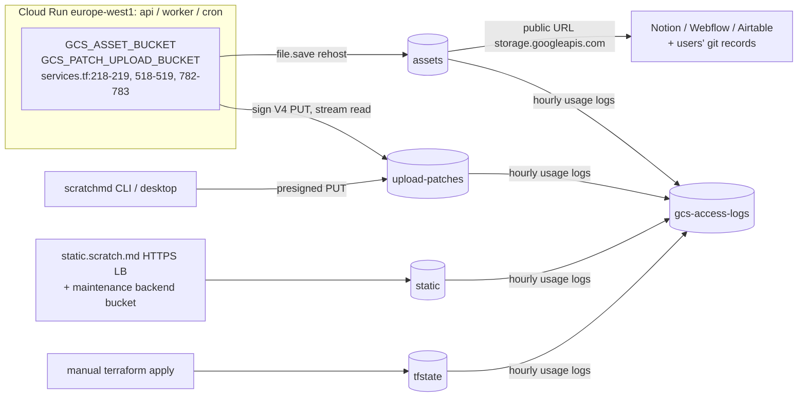

# Production GCS buckets → multi-region `EU` (Vanta redundant-backup test)

- **Created:** 2026-10-08
- **Author:** Chris Hoefgen (with Claude)
- **Linear:** [DEV-11918](https://linear.app/whalesync/issue/DEV-11918)
- **Status:** Paused on 2026-10-09. The rehearsal dry run showed that relocation needs Storage Intelligence (see [Prerequisite](#prerequisite-storage-intelligence)), and enabling it is still undecided. No prod infra has changed. Execution needs an admin principal and explicit approval per step.
- **GCP project:** `spv1eu-production` only. `spv1eu-test` is out of scope and keeps its single-region buckets.

> When fully implemented, move this doc to `docs/ops/plans/resolved/` (per `docs/ops/CLAUDE.md`).

## Problem statement

Vanta added the test [GCP Cloud Storage redundant backup](https://app.vanta.com/c/whalesync.com/tests/gcp-cloud-storage-redundant-backup/0.0?tab=results). It flags five production buckets that live in the single region `europe-west1`:

- `spv1eu-production-tfstate`
- `spv1eu-production-assets`
- `spv1eu-production-static`
- `spv1eu-production-upload-patches`
- `spv1eu-production-gcs-access-logs`

A regional outage or loss in `europe-west1` would take these out with no second copy. The test passes for multi-region or dual-region buckets. This plan moves all five to the **`EU` multi-region** without changing their names.

## Key decisions

| Decision | Choice | Why |
|---|---|---|
| Target location | **`EU` multi-region** | Simplest config (`location = "EU"`, no `custom_placement_config`). Cheapest redundant option. Data stays inside the EU, so the data-residency stance doesn't change. Accepted by Vanta. |
| Mechanism | **In-place [bucket relocation](https://docs.cloud.google.com/storage/docs/bucket-relocation/overview)** (`gcloud storage buckets relocate`), **not** recreate-and-copy | Relocation keeps the bucket name, so every URL and reference keeps working. A new bucket name is not workable for assets or tfstate (see below). |
| Not Terraform | Relocate out of band, then align Terraform | In `hashicorp/google` 7.18.0 (pinned in `terraform/envs/eu-production/.terraform.lock.hcl`), `location` and `custom_placement_config.data_locations` are both `ForceNew`. Changing `location` in Terraform plans a **destroy + recreate**, not a move. |
| Scope | **All 5 buckets**, no Vanta exceptions | The total is ~15 GB, so the cost difference is negligible. Moving everything keeps the Vanta test fully green without written exceptions for the ephemeral buckets. |
| Environments | **Production only** | The Vanta finding is prod-only. eu-test keeps `var.gcp_region`. |

### Why a new bucket name is off the table

- **assets.** The server builds the public URL `https://storage.googleapis.com/spv1eu-production-assets/<key>` (`ObjectStorageService.buildPublicUrlPrefixForAssetBucket` in `server/src/asset/object-storage.service.ts`). That URL is stored in several places:
  - Postgres `Asset.rehostedUrl` (`server/prisma/schema.prisma:1216`).
  - Pending asset-upload operations in `PublishPlanOperation.content`.
  - **Customers' own systems.** Notion stores it as an `external` hot-link (`server/src/remote-service/connectors/library/notion/notion-connector.ts:1597-1605`), and the next pull writes it back into users' git records. We can't rewrite those copies, so the name must survive. See also DEV-10982 / WSG-001 for why this bucket is intentionally public.
- **tfstate.** The name is hardcoded in the backend config (`terraform/envs/eu-production/backend.tf:5`). The bucket is also managed from inside the very state it stores (`terraform/envs/eu-production/eu-production.tf:141-175`). Renaming it would mean a state migration on top of a bucket swap.
- **The other three** are wired through Terraform outputs and env vars, so they could be renamed. But relocation is simpler and identical for all five, so one procedure covers everything.

## Current state

Sizes are from read-only Cloud Monitoring `storage.googleapis.com/storage/v2/total_bytes` and `.../total_count` on 2026-10-08. Writers are from a read of the code and Terraform.

| Bucket | Terraform | Size | Objects | Writers |
|---|---|---:|---:|---|
| `-assets` | `terraform/modules/env/main.tf:633` | 15.0 GB | 71,809 | Rehost job via `file.save` (`object-storage.service.ts:96`) |
| `-gcs-access-logs` | `terraform/modules/env/main.tf:593` | 43 MB | 14,357 | GCS hourly usage-log delivery (`cloud-storage-analytics@google.com`) |
| `-tfstate` | `terraform/envs/eu-production/eu-production.tf:146` | 32 MB | 54 | Manual `terraform apply` only. CI never runs Terraform. |
| `-static` | `terraform/modules/static_bucket_lb/main.tf:10` | 0.5 MB | 44 | Manual `gcloud storage cp` of connector/model/OS icons. Terraform-managed `maintenance/*` objects (`terraform/modules/env/maintenance.tf:113-131`). |
| `-upload-patches` | `terraform/modules/env/main.tf:708` | ~0 | 2 | CLI and desktop presigned V4 PUT (`object-storage.service.ts:135-149`). Objects are deleted after 24h. |

The buckets themselves meet relocation's requirements, but the project doesn't (see [Prerequisite](#prerequisite-storage-intelligence)):

- `soft_delete_policy` is 7 days on every bucket, and relocation requires at least 7 days.
- Terraform sets no retention policy, CMEK, hierarchical namespace, Autoclass or bucket tags on any of them.
- No org policy restricts resource locations.
- The read-only SA can't describe the buckets (`storage.buckets.get` is denied), so the `--dry-run` in step 3 is the authoritative compatibility check.

### Prerequisite: Storage Intelligence

[Bucket relocation is only available with Storage Intelligence](https://docs.cloud.google.com/storage/docs/bucket-relocation/overview), configured for **both** the source and destination locations. The plan originally missed this. The 2026-10-09 rehearsal dry run failed with:

```
HTTPError 412: Storage Intelligence subscription is required in both the source and destination regions
to use this feature. The following locations are missing the subscription: 'EUROPE-WEST1, EU'.
```

Neither project has it. `gcloud storage intelligence-configs describe --project=<p>` returns `editionConfig: INHERIT` and `effectiveEdition: NONE` for both `spv1eu-test` and `spv1eu-production`. So no folder- or org-level config applies either.

| Edition | Cost | Notes |
|---|---|---|
| [`TRIAL`](https://docs.cloud.google.com/storage/docs/storage-intelligence/30-day-introductory-trial/overview) | No object management fee for 30 days | Includes relocation. Can be activated **once per project**. **Auto-upgrades to `STANDARD` and starts billing** unless disabled before day 30. |
| `STANDARD` | $0.0025 per 1,000 objects per month, across every bucket in scope | About $0.22/mo for either project (~86k objects in prod, ~88k in test) |

The proposed approach is to enable `TRIAL` per project only for the relocation window, then disable it. The commands are in runbook [step 0](#0-enable-storage-intelligence-per-project) and [step 7](#7-close-out). This is a project-level, out-of-band config change, so it needs explicit approval. Enabling and disabling needs `storage.intelligenceConfigs.update` (Storage Admin).



Nothing depends on `europe-west1` specifically:

- Public and signed URLs use the global `storage.googleapis.com` host.
- The SDK uses its default global endpoint; no `GCS_API_ENDPOINT` is set in prod.
- Global LB backend buckets accept a bucket in any location.
- Neither backend bucket has CDN enabled.

## Cost check vs the cost-reduction plan (DEV-11808)

The [hosting cost review](../dev-11808-scratch-hosting-cost-review.md) has no Cloud Storage line item. GCS is too small to show up next to Compute, Cloud Run and Cloud SQL. **This change doesn't conflict with it.**

| Item | Estimate |
|---|---|
| Storage, ~15 GB at ~+$0.006/GB-mo (EU multi-region ~$0.026 vs `europe-west1` ~$0.020, Standard) | **~+$0.10/mo** |
| Multi-region replication of new writes, plus higher Class A op prices | Cents/mo at current write volume |
| One-time relocation (data movement + ops on ~72k objects) | ~$1–2 one-time |
| Storage Intelligence (required for relocation) | $0 on `TRIAL` if disabled within 30 days. Otherwise ~$0.22/mo per project on `STANDARD`. |

Confirm the exact SKUs on the [Cloud Storage pricing page](https://cloud.google.com/storage/pricing) before executing. Even at several times these estimates the change stays well under $5/mo.

## How relocation behaves (what to expect)

Moving a single region to a multi-region is a **write-downtime relocation**:

1. **Setup** takes 1–2 hours regardless of size.
2. **Incremental copy.** Data is copied to `EU` in the background.
   - **Reads and object writes keep working.**
   - **Bucket metadata is write-locked from the moment the relocation starts.** That covers IAM, CORS, lifecycle, logging, labels and versioning, so no `terraform apply` may touch these buckets until it finishes.
   - New XML-API multipart uploads fail. We don't use them; the patch upload is a single PUT.
3. **Final sync** (`--finalize`). The bucket is write-locked and every object write fails until the sync completes.
   - The operation reports `estimatedWriteDowntimeDuration` beforehand.
   - `--ttl` (default 12h) bounds the operation: if it hasn't succeeded by then, the write lock is reverted.
   - In-progress resumable uploads must finish before finalizing.

The whole relocation must finish within **28 days**. A failed relocation can't be retried to the same destination for 7–14 days.

### Impact of the write lock per bucket

| Bucket | During the final-sync write lock | Recovery |
|---|---|---|
| tfstate | `terraform apply` and state locking fail | Don't run Terraform. Nothing to recover. |
| static | Icon uploads fail. Reads and the LB keep serving. | Don't upload. Don't apply the maintenance-mode Terraform. |
| gcs-access-logs | GCS usage-log delivery may fail | **Possible small gap** in access logs for the lock window. GCS may or may not retry delivery; check the gap in step 4. |
| upload-patches | CLI/desktop publish fails at the patch PUT | The user retries the publish |
| assets | Asset rehosts fail | Self-heals: a failed rehost leaves `rehostedUrl` null, and the next rehost run selects `rehostedUrl: null` (`server/src/worker/jobs/job-definitions/rehost-assets.job.ts:83`) |

With fewer than 10 external users, a low-traffic window is enough. If the reported write downtime for assets or upload-patches is long (over ~30 min), quiesce writers with `terraform/tools/maintenance_mode.sh`. It works through Cloud Armor and Cloud Run and doesn't write to the static bucket.

## Runbook

Every step that changes GCP state needs explicit approval at execution time. Relocation and Storage Intelligence need `roles/storage.admin` (`storage.buckets.relocate`, `storage.bucketOperations.*`, `storage.intelligenceConfigs.update`). The per-dev read-only SAs don't have it.

**How to run the commands.** The commands are written out in full, with no shell variables, so you can paste them one at a time.

- Every command that changes GCP state passes `--configuration=admin`. That's a gcloud configuration logged in as an identity with Storage Admin on the project (for example `role_operations@`), so the shell's active config can stay read-only. If your admin configuration has a different name, change the flag.
- Read-only checks (Monitoring, `curl`, `terraform plan`) use your normal credentials.
- The only placeholders are `<OPERATION_ID>` and `<REHOSTED_URL>`. The relocate command prints the operation ID, and `gcloud storage operations list` shows it too.
- The `date -u -v-2d` syntax is macOS `date`.

The 2026-10-09 rehearsal used a personal Whalesync account this way. In `spv1eu-test` it could create buckets, and the relocate dry run returned the Storage Intelligence 412 rather than a 403. This is unconfirmed for prod.

### 0. Enable Storage Intelligence (per project)

Enable `TRIAL` on a project before its first dry run, and disable it after its last relocation succeeds (see [Prerequisite](#prerequisite-storage-intelligence)).

- Set a reminder for day 25 after enabling. If a relocation is still running then, decide whether to let it upgrade to `STANDARD` or cancel.
- Don't disable while any relocation operation is still in progress. What that would do to the operation is undocumented.

Before the rehearsal (step 1):

```bash
gcloud --configuration=admin storage intelligence-configs enable --project=spv1eu-test --trial-edition
gcloud --configuration=admin storage intelligence-configs describe --project=spv1eu-test --format=json
```

Before the first prod relocation (step 3), and only once the relocation window is booked, because the trial is one-time per project:

```bash
gcloud --configuration=admin storage intelligence-configs enable --project=spv1eu-production --trial-edition
gcloud --configuration=admin storage intelligence-configs describe --project=spv1eu-production --format=json
```

After enabling, `effectiveEdition` should no longer be `NONE`. Note the trial's expiry date from the output.

### 1. Rehearsal in `spv1eu-test` (throwaway bucket)

Before touching prod, prove the relocation preserves what we rely on. Do this on a scratch bucket, **not** a Terraform-managed test bucket. Relocating a managed test bucket would drift it from `var.gcp_region`, and the next test apply would plan a replacement.

Needs step 0 on `spv1eu-test` first. The 2026-10-09 attempt got through items 1 and 2 (bucket created, seeded, IAM, CORS and logging confirmed, public URL `200`, bucket listing `403`). It then stopped at the item 4 dry run with the Storage Intelligence 412, and the bucket was deleted.

**1. Create the bucket, shaped like `-assets`.** That means uniform bucket-level access, versioning, 7-day soft delete, `GET` CORS, noncurrent-version lifecycle, usage logging and `allUsers` object read:

```bash
gcloud --configuration=admin storage buckets create gs://spv1eu-test-relocation-rehearsal --project=spv1eu-test --location=europe-west1 --uniform-bucket-level-access --soft-delete-duration=7d

echo '[{"method": ["GET"], "origin": ["test.scratch.md"]}]' > /tmp/dev-11918-cors.json
echo '{"rule": [{"action": {"type": "Delete"}, "condition": {"daysSinceNoncurrentTime": 30}}]}' > /tmp/dev-11918-lifecycle.json

gcloud --configuration=admin storage buckets update gs://spv1eu-test-relocation-rehearsal --versioning --cors-file=/tmp/dev-11918-cors.json --lifecycle-file=/tmp/dev-11918-lifecycle.json --log-bucket=spv1eu-test-gcs-access-logs --update-labels=purpose=dev-11918-rehearsal

gcloud --configuration=admin storage buckets add-iam-policy-binding gs://spv1eu-test-relocation-rehearsal --member=allUsers --role=projects/spv1eu-test/roles/assetsObjectReader --format=none
```

**2. Seed and record the "before" state.** The commands create 300 objects, overwrite 20 of them (20 noncurrent versions), and delete all versions of one (1 soft-deleted object). With versioning on, a plain `rm` only makes an object noncurrent; it doesn't soft-delete it, hence `--all-versions`.

```bash
mkdir -p /tmp/dev-11918-seed /tmp/dev-11918-overwrite
for i in $(seq -f '%03g' 1 300); do echo "rehearsal object $i v1" > /tmp/dev-11918-seed/obj-$i.txt; done
for i in $(seq -f '%03g' 1 20); do echo "rehearsal object $i v2" > /tmp/dev-11918-overwrite/obj-$i.txt; done

gcloud --configuration=admin storage cp '/tmp/dev-11918-seed/*' gs://spv1eu-test-relocation-rehearsal/seed/
gcloud --configuration=admin storage cp '/tmp/dev-11918-overwrite/*' gs://spv1eu-test-relocation-rehearsal/seed/
gcloud --configuration=admin storage rm --all-versions gs://spv1eu-test-relocation-rehearsal/seed/obj-300.txt

gcloud --configuration=admin storage buckets describe gs://spv1eu-test-relocation-rehearsal --format=json > /tmp/dev-11918-before-describe.json
gcloud --configuration=admin storage buckets get-iam-policy gs://spv1eu-test-relocation-rehearsal --format=json > /tmp/dev-11918-before-iam.json

gcloud --configuration=admin storage ls 'gs://spv1eu-test-relocation-rehearsal/seed/**' | wc -l                               # expect 299 live
gcloud --configuration=admin storage ls -a 'gs://spv1eu-test-relocation-rehearsal/seed/**' | wc -l                            # expect 319 (299 live + 20 noncurrent)
gcloud --configuration=admin storage ls --soft-deleted --exhaustive 'gs://spv1eu-test-relocation-rehearsal/seed/**' | wc -l   # expect 1
curl -so /dev/null -w '%{http_code}\n' https://storage.googleapis.com/spv1eu-test-relocation-rehearsal/seed/obj-002.txt        # expect 200
```

**3. Start the probes.** Run each in its own terminal and leave them running until item 6. The write probe writes under `probe/`, so the `seed/` counts stay comparable.

```bash
# Terminal A: public read probe, every 10s
while true; do echo "$(date -u +%H:%M:%S) $(curl -so /dev/null -w '%{http_code}' https://storage.googleapis.com/spv1eu-test-relocation-rehearsal/seed/obj-002.txt)"; sleep 10; done | tee /tmp/dev-11918-read-probe.log
```

```bash
# Terminal B: object write probe, every 30s
while true; do if gcloud --configuration=admin storage cp /tmp/dev-11918-seed/obj-001.txt gs://spv1eu-test-relocation-rehearsal/probe/write-$(date -u +%H%M%S).txt >/dev/null 2>&1; then echo "$(date -u +%H:%M:%S) write ok"; else echo "$(date -u +%H:%M:%S) WRITE FAILED"; fi; sleep 30; done | tee /tmp/dev-11918-write-probe.log
```

**4. Relocate, monitor and finalize:**

```bash
# Compatibility check: no data moves
gcloud --configuration=admin storage buckets relocate gs://spv1eu-test-relocation-rehearsal --location=EU --dry-run

# Start the relocation; note the operation ID it prints
gcloud --configuration=admin storage buckets relocate gs://spv1eu-test-relocation-rehearsal --location=EU
gcloud --configuration=admin storage operations list gs://spv1eu-test-relocation-rehearsal

# Metadata should now be locked: this should be REJECTED
gcloud --configuration=admin storage buckets update gs://spv1eu-test-relocation-rehearsal --update-labels=probe=metadata-lock

# Repeat until the incremental copy is done (setup alone takes 1-2h); note estimatedWriteDowntimeDuration
gcloud --configuration=admin storage operations describe projects/_/buckets/spv1eu-test-relocation-rehearsal/operations/<OPERATION_ID>

# Final sync (write lock)
gcloud --configuration=admin storage buckets relocate --operation=projects/_/buckets/spv1eu-test-relocation-rehearsal/operations/<OPERATION_ID> --finalize --ttl=2h

# Repeat until done
gcloud --configuration=admin storage operations describe projects/_/buckets/spv1eu-test-relocation-rehearsal/operations/<OPERATION_ID>
```

**5. Compare against "before":**

```bash
gcloud --configuration=admin storage buckets describe gs://spv1eu-test-relocation-rehearsal --format='value(location,location_type)'   # expect EU  multi-region

gcloud --configuration=admin storage buckets describe gs://spv1eu-test-relocation-rehearsal --format=json > /tmp/dev-11918-after-describe.json
gcloud --configuration=admin storage buckets get-iam-policy gs://spv1eu-test-relocation-rehearsal --format=json > /tmp/dev-11918-after-iam.json

# Expect no output from either diff: IAM, CORS, lifecycle, logging, versioning, soft delete and labels unchanged
diff <(jq 'del(.location, .location_type, .update_time, .metageneration)' /tmp/dev-11918-before-describe.json) <(jq 'del(.location, .location_type, .update_time, .metageneration)' /tmp/dev-11918-after-describe.json)
diff <(jq 'del(.etag)' /tmp/dev-11918-before-iam.json) <(jq 'del(.etag)' /tmp/dev-11918-after-iam.json)

# Versions and soft deletes carried over? Expect 299 / 319 / 1 again
gcloud --configuration=admin storage ls 'gs://spv1eu-test-relocation-rehearsal/seed/**' | wc -l
gcloud --configuration=admin storage ls -a 'gs://spv1eu-test-relocation-rehearsal/seed/**' | wc -l
gcloud --configuration=admin storage ls --soft-deleted --exhaustive 'gs://spv1eu-test-relocation-rehearsal/seed/**' | wc -l

# Public URL served 200 throughout: expect no output
grep -v ' 200$' /tmp/dev-11918-read-probe.log

# Measured write lock: first-to-last FAILED timestamp, vs estimatedWriteDowntimeDuration
grep 'WRITE FAILED' /tmp/dev-11918-write-probe.log
```

**6. Tear down.** Stop both probes with Ctrl-C first.

```bash
gcloud --configuration=admin storage rm -r --all-versions gs://spv1eu-test-relocation-rehearsal
gcloud --configuration=admin storage buckets describe gs://spv1eu-test-relocation-rehearsal   # expect 404
gcloud --configuration=admin storage intelligence-configs disable --project=spv1eu-test
rm -rf /tmp/dev-11918-*
```

Record the results (versions, soft deletes, measured write-lock window) in this doc's open questions.

### 2. Prep

- Announce a **prod Terraform freeze** for the five buckets, from the first relocate until the step 5 MR is merged and planned clean.
- Draft the step 5 Terraform MR in advance.
- Turn the `REHOSTED_ASSET_REAPER_DELETES_ENABLED` PostHog flag off before relocating assets, and back on after step 4 passes (DEV-12324). The nightly rehosted-asset reaper deletes unreferenced objects from that bucket, and its deletes would fail under the finalize write lock.
- Record the baseline size and object count per bucket, and re-run it on the day of the relocation. The `location` column also confirms each move later, once it flips to `eu`. The metric lags by a few hours.

```bash
curl -s -G "https://monitoring.googleapis.com/v3/projects/spv1eu-production/timeSeries" \
  -H "Authorization: Bearer $(gcloud auth print-access-token)" -H "x-goog-user-project: spv1eu-production" \
  --data-urlencode 'filter=metric.type="storage.googleapis.com/storage/v2/total_bytes" AND resource.type="gcs_bucket"' \
  --data-urlencode "interval.startTime=$(date -u -v-2d +%Y-%m-%dT%H:%M:%SZ)" \
  --data-urlencode "interval.endTime=$(date -u +%Y-%m-%dT%H:%M:%SZ)" \
  --data-urlencode "aggregation.alignmentPeriod=86400s" \
  --data-urlencode "aggregation.perSeriesAligner=ALIGN_MAX" \
  --data-urlencode "aggregation.crossSeriesReducer=REDUCE_SUM" \
  --data-urlencode "aggregation.groupByFields=resource.label.bucket_name" \
  --data-urlencode "aggregation.groupByFields=resource.label.location" \
  | jq -r '.timeSeries[] | [.resource.labels.bucket_name, .resource.labels.location, (.points[0].value | .int64Value // .doubleValue)] | @tsv'

curl -s -G "https://monitoring.googleapis.com/v3/projects/spv1eu-production/timeSeries" \
  -H "Authorization: Bearer $(gcloud auth print-access-token)" -H "x-goog-user-project: spv1eu-production" \
  --data-urlencode 'filter=metric.type="storage.googleapis.com/storage/v2/total_count" AND resource.type="gcs_bucket"' \
  --data-urlencode "interval.startTime=$(date -u -v-2d +%Y-%m-%dT%H:%M:%SZ)" \
  --data-urlencode "interval.endTime=$(date -u +%Y-%m-%dT%H:%M:%SZ)" \
  --data-urlencode "aggregation.alignmentPeriod=86400s" \
  --data-urlencode "aggregation.perSeriesAligner=ALIGN_MAX" \
  --data-urlencode "aggregation.crossSeriesReducer=REDUCE_SUM" \
  --data-urlencode "aggregation.groupByFields=resource.label.bucket_name" \
  --data-urlencode "aggregation.groupByFields=resource.label.location" \
  | jq -r '.timeSeries[] | [.resource.labels.bucket_name, .resource.labels.location, (.points[0].value | .int64Value // .doubleValue)] | @tsv'
```

Baseline from 2026-10-09:

| Bucket | Location | Size | Objects |
|---|---|---:|---:|
| `-assets` | europe-west1 | 14.989 GB | 71,809 |
| `-gcs-access-logs` | europe-west1 | 0.043 GB | 14,357 |
| `-tfstate` | europe-west1 | 0.032 GB | 54 |
| `-static` | europe-west1 | 0.000 GB | 44 |
| `-upload-patches` | europe-west1 | 0.000 GB | 2 |

### 3. Relocate each bucket, lowest risk first

Order: **static → tfstate → gcs-access-logs → upload-patches → assets.** Needs step 0 on `spv1eu-production` first; without it, every dry run returns the 412. Finish and verify (step 4) one bucket before starting the next.

Every bucket uses the same six commands:

1. Dry run (no data moves).
2. Start (setup + incremental copy; reads and object writes keep working). Note the operation ID.
3. List operations, if you need the ID again.
4. Monitor until the copy is done, and note `estimatedWriteDowntimeDuration`.
5. In a low-traffic window, finalize (write lock). `--ttl` reverts the write lock if it hasn't succeeded by then.
6. Monitor until it reports success / `progressPercent` 100.

The last line of each block, commented out, aborts the relocation if you run it before finalizing.

#### 3a. static

```bash
gcloud --configuration=admin storage buckets relocate gs://spv1eu-production-static --location=EU --dry-run
gcloud --configuration=admin storage buckets relocate gs://spv1eu-production-static --location=EU
gcloud --configuration=admin storage operations list gs://spv1eu-production-static
gcloud --configuration=admin storage operations describe projects/_/buckets/spv1eu-production-static/operations/<OPERATION_ID>
gcloud --configuration=admin storage buckets relocate --operation=projects/_/buckets/spv1eu-production-static/operations/<OPERATION_ID> --finalize --ttl=6h
gcloud --configuration=admin storage operations describe projects/_/buckets/spv1eu-production-static/operations/<OPERATION_ID>
# abort: gcloud --configuration=admin storage operations cancel projects/_/buckets/spv1eu-production-static/operations/<OPERATION_ID>
```

#### 3b. tfstate

Nobody may run `terraform apply` against prod until this finishes.

```bash
gcloud --configuration=admin storage buckets relocate gs://spv1eu-production-tfstate --location=EU --dry-run
gcloud --configuration=admin storage buckets relocate gs://spv1eu-production-tfstate --location=EU
gcloud --configuration=admin storage operations list gs://spv1eu-production-tfstate
gcloud --configuration=admin storage operations describe projects/_/buckets/spv1eu-production-tfstate/operations/<OPERATION_ID>
gcloud --configuration=admin storage buckets relocate --operation=projects/_/buckets/spv1eu-production-tfstate/operations/<OPERATION_ID> --finalize --ttl=6h
gcloud --configuration=admin storage operations describe projects/_/buckets/spv1eu-production-tfstate/operations/<OPERATION_ID>
# abort: gcloud --configuration=admin storage operations cancel projects/_/buckets/spv1eu-production-tfstate/operations/<OPERATION_ID>
```

#### 3c. gcs-access-logs

```bash
gcloud --configuration=admin storage buckets relocate gs://spv1eu-production-gcs-access-logs --location=EU --dry-run
gcloud --configuration=admin storage buckets relocate gs://spv1eu-production-gcs-access-logs --location=EU
gcloud --configuration=admin storage operations list gs://spv1eu-production-gcs-access-logs
gcloud --configuration=admin storage operations describe projects/_/buckets/spv1eu-production-gcs-access-logs/operations/<OPERATION_ID>
gcloud --configuration=admin storage buckets relocate --operation=projects/_/buckets/spv1eu-production-gcs-access-logs/operations/<OPERATION_ID> --finalize --ttl=6h
gcloud --configuration=admin storage operations describe projects/_/buckets/spv1eu-production-gcs-access-logs/operations/<OPERATION_ID>
# abort: gcloud --configuration=admin storage operations cancel projects/_/buckets/spv1eu-production-gcs-access-logs/operations/<OPERATION_ID>
```

#### 3d. upload-patches

Finalize in the low-traffic window: CLI and desktop publishes fail during the write lock.

```bash
gcloud --configuration=admin storage buckets relocate gs://spv1eu-production-upload-patches --location=EU --dry-run
gcloud --configuration=admin storage buckets relocate gs://spv1eu-production-upload-patches --location=EU
gcloud --configuration=admin storage operations list gs://spv1eu-production-upload-patches
gcloud --configuration=admin storage operations describe projects/_/buckets/spv1eu-production-upload-patches/operations/<OPERATION_ID>
gcloud --configuration=admin storage buckets relocate --operation=projects/_/buckets/spv1eu-production-upload-patches/operations/<OPERATION_ID> --finalize --ttl=6h
gcloud --configuration=admin storage operations describe projects/_/buckets/spv1eu-production-upload-patches/operations/<OPERATION_ID>
# abort: gcloud --configuration=admin storage operations cancel projects/_/buckets/spv1eu-production-upload-patches/operations/<OPERATION_ID>
```

#### 3e. assets

Before starting, turn the `REHOSTED_ASSET_REAPER_DELETES_ENABLED` PostHog flag off (step 2). Finalize in the low-traffic window: asset rehosts fail during the write lock, then self-heal.

```bash
gcloud --configuration=admin storage buckets relocate gs://spv1eu-production-assets --location=EU --dry-run
gcloud --configuration=admin storage buckets relocate gs://spv1eu-production-assets --location=EU
gcloud --configuration=admin storage operations list gs://spv1eu-production-assets
gcloud --configuration=admin storage operations describe projects/_/buckets/spv1eu-production-assets/operations/<OPERATION_ID>
gcloud --configuration=admin storage buckets relocate --operation=projects/_/buckets/spv1eu-production-assets/operations/<OPERATION_ID> --finalize --ttl=6h
gcloud --configuration=admin storage operations describe projects/_/buckets/spv1eu-production-assets/operations/<OPERATION_ID>
# abort: gcloud --configuration=admin storage operations cancel projects/_/buckets/spv1eu-production-assets/operations/<OPERATION_ID>
```

### 4. Verify each bucket

Location: each line should print `EU  multi-region` once that bucket's relocation succeeds.

```bash
gcloud --configuration=admin storage buckets describe gs://spv1eu-production-static --format='value(location,location_type)'
gcloud --configuration=admin storage buckets describe gs://spv1eu-production-tfstate --format='value(location,location_type)'
gcloud --configuration=admin storage buckets describe gs://spv1eu-production-gcs-access-logs --format='value(location,location_type)'
gcloud --configuration=admin storage buckets describe gs://spv1eu-production-upload-patches --format='value(location,location_type)'
gcloud --configuration=admin storage buckets describe gs://spv1eu-production-assets --format='value(location,location_type)'
```

Size and object count: re-run the two step 2 queries. They should match the baseline, with `location` now `eu`.

Per-bucket checks:

- **static:** expect `HTTP/2 200`.

  ```bash
  curl -sI https://static.scratch.md/connector-icons/airtable.svg | head -1
  ```

- **assets:** pick a recent rehosted URL with the read-only DB script and expect `200`. A pull with asset rehosting should also produce new rehosted URLs.

  ```bash
  terraform/tools/connect_to_gcp_db_readonly.sh production 'SELECT "rehostedUrl" FROM "Asset" WHERE "rehostedUrl" IS NOT NULL ORDER BY "rehostedAt" DESC LIMIT 1'
  curl -sI '<REHOSTED_URL>' | head -1
  ```

- **upload-patches:** a CLI `scratchmd` publish succeeds end to end.
- **tfstate:** `plan` must read and lock state. Expect replacement drift on the relocated buckets until step 5. **Don't apply.**

  ```bash
  terraform -chdir=terraform/envs/eu-production init
  terraform -chdir=terraform/envs/eu-production plan
  ```

- **gcs-access-logs:** today's hourly usage logs keep arriving after the write lock lifts. The newest timestamps in the object names should be later than the finalize.

  ```bash
  gcloud --configuration=admin storage ls "gs://spv1eu-production-gcs-access-logs/spv1eu-production-assets_usage_$(date -u +%Y_%m_%d)_*"
  ```

### 5. Align Terraform (isolated MR, after all relocations succeed)

Until this lands, any prod `terraform plan` shows `-/+ … must be replaced` for every relocated bucket. `force_destroy = false` blocks deleting a non-empty bucket, but **upload-patches is often empty and could really be destroyed and recreated in `europe-west1`**. Keep the freeze until this MR is planned clean.

- In `terraform/modules/env/variables.tf`, add `gcs_bucket_location`, defaulting to `null` and resolved as `coalesce(var.gcs_bucket_location, var.gcp_region)`, so eu-test is unchanged.
- Use it for `google_storage_bucket.gcs_access_logs`, `.assets`, `.upload_patches`, and for `module.static_bucket_lb`'s `bucket_location` (`terraform/modules/env/main.tf:767`).
- Set `gcs_bucket_location = "EU"` in `terraform/envs/eu-production/eu-production.tf`.
- Change `google_storage_bucket.tfstate` to `location = "EU"` (`eu-production.tf:149`).
- **Gate:** both plans must show **no changes** for the buckets. Any `must be replaced` means stop and investigate. Never `-auto-approve`.

```bash
terraform -chdir=terraform/envs/eu-production plan
terraform -chdir=terraform/envs/eu-test plan
```

### 6. Rollback

Before finalizing, the `abort` line in that bucket's step 3 block cancels the relocation and leaves the bucket where it was.

After a successful relocation, move the bucket back with another write-downtime relocation. It has the same steps and the same 28-day limit. Dry-run and start it with that bucket's line below, then monitor and finalize with that bucket's step 3 `describe` and `--finalize` commands, using the new operation ID. Revert the step 5 MR to match.

```bash
gcloud --configuration=admin storage buckets relocate gs://spv1eu-production-static --location=europe-west1 --dry-run
gcloud --configuration=admin storage buckets relocate gs://spv1eu-production-static --location=europe-west1

gcloud --configuration=admin storage buckets relocate gs://spv1eu-production-tfstate --location=europe-west1 --dry-run
gcloud --configuration=admin storage buckets relocate gs://spv1eu-production-tfstate --location=europe-west1

gcloud --configuration=admin storage buckets relocate gs://spv1eu-production-gcs-access-logs --location=europe-west1 --dry-run
gcloud --configuration=admin storage buckets relocate gs://spv1eu-production-gcs-access-logs --location=europe-west1

gcloud --configuration=admin storage buckets relocate gs://spv1eu-production-upload-patches --location=europe-west1 --dry-run
gcloud --configuration=admin storage buckets relocate gs://spv1eu-production-upload-patches --location=europe-west1

gcloud --configuration=admin storage buckets relocate gs://spv1eu-production-assets --location=europe-west1 --dry-run
gcloud --configuration=admin storage buckets relocate gs://spv1eu-production-assets --location=europe-west1
```

Storage Intelligence must still be enabled on the project for a rollback. Don't do step 7 until you're confident no rollback is needed, and stay within the trial's 30 days.

### 7. Close out

- Re-run the Vanta test and confirm all five buckets pass.
- Disable Storage Intelligence on prod and confirm it reports `NONE`. If the step 1 teardown didn't already disable it on test, do the same there.

  ```bash
  gcloud --configuration=admin storage intelligence-configs disable --project=spv1eu-production
  gcloud --configuration=admin storage intelligence-configs describe --project=spv1eu-production --format='value(effectiveIntelligenceConfig.effectiveEdition)'
  gcloud --configuration=admin storage intelligence-configs describe --project=spv1eu-test --format='value(effectiveIntelligenceConfig.effectiveEdition)'
  ```

- Lift the Terraform freeze, close DEV-11918, and move this doc to `docs/ops/plans/resolved/`.

## Open questions

- **Storage Intelligence:** approve enabling `TRIAL` on `spv1eu-test` (rehearsal) and `spv1eu-production` (relocation), or choose `STANDARD`. The trial is one-time per project, so enable it on prod only once the relocation window is booked.
- Do **noncurrent versions and soft-deleted objects** carry over? Google's docs only say object metadata is retained. The step 1 rehearsal answers this.
- Does GCS **retry usage-log delivery** into `gcs-access-logs` while it's write-locked, or is that window lost? Check in step 4.
- What are the exact **pricing SKUs** for the relocation and EU multi-region? Check on the pricing page before executing.
- **Who runs it:** which admin principal (`role_operations@`), and when is the low-traffic window for the assets and upload-patches finalize?
