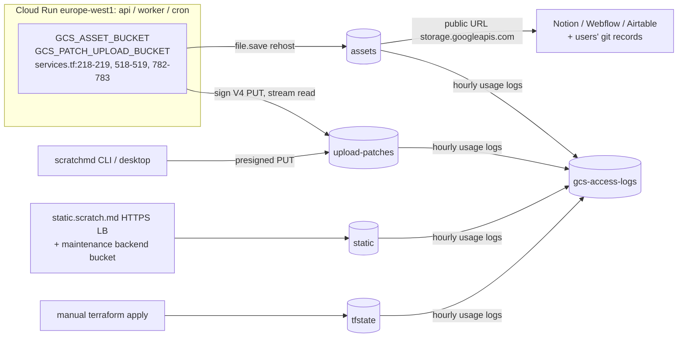

# Production GCS buckets → multi-region `EU` (Vanta redundant-backup test)

- **Created:** 2026-10-08
- **Author:** Chris Hoefgen (with Claude)
- **Linear:** [DEV-11918](https://linear.app/whalesync/issue/DEV-11918)
- **Status:** Proposed. No infra changed yet. Execution needs an admin principal and explicit approval per step.
- **GCP project:** `spv1eu-production` only. `spv1eu-test` is out of scope and keeps its single-region buckets.

> When fully implemented, move this doc to `docs/ops/plans/resolved/` (per `docs/ops/CLAUDE.md`).

## Problem statement

Vanta added the test [GCP Cloud Storage redundant backup](https://app.vanta.com/c/whalesync.com/tests/gcp-cloud-storage-redundant-backup/0.0?tab=results). It flags five production buckets that live in the single region `europe-west1`:

- `spv1eu-production-tfstate`
- `spv1eu-production-assets`
- `spv1eu-production-static`
- `spv1eu-production-upload-patches`
- `spv1eu-production-gcs-access-logs`

A regional outage or loss in `europe-west1` would take these out with no second copy. The test passes for multi-region or dual-region buckets. This plan moves all five to the **`EU` multi-region** without changing their names.

## Key decisions

| Decision | Choice | Why |
|---|---|---|
| Target location | **`EU` multi-region** | Simplest config (`location = "EU"`, no `custom_placement_config`). Cheapest redundant option. Data stays inside the EU, so the data-residency stance doesn't change. Accepted by Vanta. |
| Mechanism | **In-place [bucket relocation](https://docs.cloud.google.com/storage/docs/bucket-relocation/overview)** (`gcloud storage buckets relocate`), **not** recreate-and-copy | Relocation keeps the bucket name, so every URL and reference keeps working. A new bucket name is not workable for assets or tfstate (see below). |
| Not Terraform | Relocate out of band, then align Terraform | In `hashicorp/google` 7.18.0 (pinned in `terraform/envs/eu-production/.terraform.lock.hcl`), `location` and `custom_placement_config.data_locations` are both `ForceNew`. Changing `location` in Terraform plans a **destroy + recreate**, not a move. |
| Scope | **All 5 buckets**, no Vanta exceptions | The total is ~15 GB, so the cost difference is negligible. Moving everything keeps the Vanta test fully green without written exceptions for the ephemeral buckets. |
| Environments | **Production only** | The Vanta finding is prod-only. eu-test keeps `var.gcp_region`. |

### Why a new bucket name is off the table

- **assets.** The server builds the public URL `https://storage.googleapis.com/spv1eu-production-assets/<key>` (`ObjectStorageService.buildPublicUrlPrefixForAssetBucket` in `server/src/asset/object-storage.service.ts`). That URL is stored in several places:
  - Postgres `Asset.rehostedUrl` (`server/prisma/schema.prisma:1216`).
  - Pending asset-upload operations in `PublishPlanOperation.content`.
  - **Customers' own systems.** Notion stores it as an `external` hot-link (`server/src/remote-service/connectors/library/notion/notion-connector.ts:1597-1605`), and the next pull writes it back into users' git records. We can't rewrite those copies, so the name must survive. See also DEV-10982 / WSG-001 for why this bucket is intentionally public.
- **tfstate.** The name is hardcoded in the backend config (`terraform/envs/eu-production/backend.tf:5`). The bucket is also managed from inside the very state it stores (`terraform/envs/eu-production/eu-production.tf:141-175`). Renaming it would mean a state migration on top of a bucket swap.
- **The other three** are wired through Terraform outputs and env vars, so they could be renamed. But relocation is simpler and identical for all five, so one procedure covers everything.

## Current state

Sizes are from read-only Cloud Monitoring `storage.googleapis.com/storage/v2/total_bytes` and `.../total_count` on 2026-10-08. Writers are from a read of the code and Terraform.

| Bucket | Terraform | Size | Objects | Writers |
|---|---|---:|---:|---|
| `-assets` | `terraform/modules/env/main.tf:633` | 15.0 GB | 71,809 | Rehost job via `file.save` (`object-storage.service.ts:96`) |
| `-gcs-access-logs` | `terraform/modules/env/main.tf:593` | 43 MB | 14,357 | GCS hourly usage-log delivery (`cloud-storage-analytics@google.com`) |
| `-tfstate` | `terraform/envs/eu-production/eu-production.tf:146` | 32 MB | 54 | Manual `terraform apply` only. CI never runs Terraform. |
| `-static` | `terraform/modules/static_bucket_lb/main.tf:10` | 0.5 MB | 44 | Manual `gcloud storage cp` of connector/model/OS icons. Terraform-managed `maintenance/*` objects (`terraform/modules/env/maintenance.tf:113-131`). |
| `-upload-patches` | `terraform/modules/env/main.tf:708` | ~0 | 2 | CLI and desktop presigned V4 PUT (`object-storage.service.ts:135-149`). Objects are deleted after 24h. |

All five already meet relocation's requirements:

- `soft_delete_policy` is 7 days on every bucket, and relocation requires at least 7 days.
- Terraform sets no retention policy, CMEK, hierarchical namespace, Autoclass or bucket tags on any of them.
- No org policy restricts resource locations.
- The read-only SA can't describe the buckets (`storage.buckets.get` is denied), so the `--dry-run` in step 3 is the authoritative compatibility check.



Nothing depends on `europe-west1` specifically:

- Public and signed URLs use the global `storage.googleapis.com` host.
- The SDK uses its default global endpoint; no `GCS_API_ENDPOINT` is set in prod.
- Global LB backend buckets accept a bucket in any location.
- Neither backend bucket has CDN enabled.

## Cost check vs the cost-reduction plan (DEV-11808)

The [hosting cost review](../dev-11808-scratch-hosting-cost-review.md) has no Cloud Storage line item. GCS is too small to show up next to Compute, Cloud Run and Cloud SQL. **This change doesn't conflict with it.**

| Item | Estimate |
|---|---|
| Storage, ~15 GB at ~+$0.006/GB-mo (EU multi-region ~$0.026 vs `europe-west1` ~$0.020, Standard) | **~+$0.10/mo** |
| Multi-region replication of new writes, plus higher Class A op prices | Cents/mo at current write volume |
| One-time relocation (data movement + ops on ~72k objects) | ~$1–2 one-time |

Confirm the exact SKUs on the [Cloud Storage pricing page](https://cloud.google.com/storage/pricing) before executing. Even at several times these estimates the change stays well under $5/mo.

## How relocation behaves (what to expect)

Moving a single region to a multi-region is a **write-downtime relocation**:

1. **Setup** takes 1–2 hours regardless of size.
2. **Incremental copy.** Data is copied to `EU` in the background.
   - **Reads and object writes keep working.**
   - **Bucket metadata is write-locked from the moment the relocation starts.** That covers IAM, CORS, lifecycle, logging, labels and versioning, so no `terraform apply` may touch these buckets until it finishes.
   - New XML-API multipart uploads fail. We don't use them; the patch upload is a single PUT.
3. **Final sync** (`--finalize`). The bucket is write-locked and every object write fails until the sync completes.
   - The operation reports `estimatedWriteDowntimeDuration` beforehand.
   - `--ttl` (default 12h) bounds the operation: if it hasn't succeeded by then, the write lock is reverted.
   - In-progress resumable uploads must finish before finalizing.

The whole relocation must finish within **28 days**. A failed relocation can't be retried to the same destination for 7–14 days.

### Impact of the write lock per bucket

| Bucket | During the final-sync write lock | Recovery |
|---|---|---|
| tfstate | `terraform apply` and state locking fail | Don't run Terraform. Nothing to recover. |
| static | Icon uploads fail. Reads and the LB keep serving. | Don't upload. Don't apply the maintenance-mode Terraform. |
| gcs-access-logs | GCS usage-log delivery may fail | **Possible small gap** in access logs for the lock window. GCS may or may not retry delivery; check the gap in step 4. |
| upload-patches | CLI/desktop publish fails at the patch PUT | The user retries the publish |
| assets | Asset rehosts fail | Self-heals: a failed rehost leaves `rehostedUrl` null, and the next rehost run selects `rehostedUrl: null` (`server/src/worker/jobs/job-definitions/rehost-assets.job.ts:83`) |

With fewer than 10 external users, a low-traffic window is enough. If the reported write downtime for assets or upload-patches is long (over ~30 min), quiesce writers with `terraform/tools/maintenance_mode.sh`. It works through Cloud Armor and Cloud Run and doesn't write to the static bucket.

## Runbook

Every step changes GCP state, so each one needs explicit approval at execution time. Relocation needs `storage.buckets.relocate` and `storage.bucketOperations.*` (`roles/storage.admin`), which the per-dev read-only SAs don't have. Run it as a `role_operations@` / admin identity.

### 1. Rehearsal in `spv1eu-test` (throwaway bucket)

Before touching prod, prove the relocation preserves what we rely on. Do this on a scratch bucket, **not** a Terraform-managed test bucket. Relocating a managed test bucket would drift it from `var.gcp_region`, and the next test apply would plan a replacement.

1. Create `gs://spv1eu-test-relocation-rehearsal` in `europe-west1`, shaped like assets:
   - uniform bucket-level access
   - versioning on, 7-day soft delete
   - CORS `GET`
   - usage logging to `spv1eu-test-gcs-access-logs`
   - `allUsers` → `projects/spv1eu-test/roles/assetsObjectReader`
2. Seed a few hundred objects, overwrite some (to create noncurrent versions) and delete one (to create a soft-deleted object). Record `gcloud storage ls -a gs://… | wc -l` and the bucket IAM, CORS and logging config.
3. `relocate --location=EU --dry-run`, then the real relocate, monitor, and `--finalize`. While it runs, `curl` a public object URL in a loop.
4. Confirm:
   - the public URL served 200 throughout
   - IAM, CORS, logging, versioning, soft delete and lifecycle are unchanged
   - noncurrent versions survived
   - whether soft-deleted objects survived
   - the measured write-downtime vs `estimatedWriteDowntimeDuration`
5. Delete the rehearsal bucket.

### 2. Prep

- Announce a **prod Terraform freeze** for the five buckets, from the first relocate until the step 5 MR is merged and planned clean.
- Draft the step 5 Terraform MR in advance.
- Record the baseline `total_bytes` and `total_count` per bucket (query below).
- Turn the `REHOSTED_ASSET_REAPER_DELETES_ENABLED` PostHog flag off before relocating assets, and back on after step 4 passes (DEV-12324). The nightly rehosted-asset reaper deletes unreferenced objects from that bucket, and its deletes would fail under the finalize write lock.

### 3. Relocate each bucket, lowest risk first

Order: **static → tfstate → gcs-access-logs → upload-patches → assets.**

```bash
B=spv1eu-production-static   # then -tfstate, -gcs-access-logs, -upload-patches, -assets

# 1. Compatibility check: no data moves
gcloud storage buckets relocate gs://$B --location=EU --dry-run

# 2. Start the relocation (setup + incremental copy; reads and object writes keep working)
gcloud storage buckets relocate gs://$B --location=EU

# 3. Monitor until the copy is done; note estimatedWriteDowntimeDuration
gcloud storage operations list gs://$B
gcloud storage operations describe projects/_/buckets/$B/operations/<OPERATION_ID>

# 4. In a low-traffic window, start the final sync (write lock).
#    --ttl bounds the operation: the write lock is reverted if it hasn't succeeded by then.
gcloud storage buckets relocate --operation=projects/_/buckets/$B/operations/<OPERATION_ID> --finalize --ttl=6h

# 5. Wait for: "Relocate bucket succeeded" / progressPercent = 100
gcloud storage operations describe projects/_/buckets/$B/operations/<OPERATION_ID>
```

To abort before finalizing, run `gcloud storage operations cancel projects/_/buckets/$B/operations/<OPERATION_ID>`.

### 4. Verify each bucket

- `gcloud storage buckets describe gs://$B --format='value(location,location_type)'` → `EU` / `multi-region`.
- `total_bytes` and `total_count` match the baseline (query below). The metric lags by a few hours.
- **static:** `curl -sI https://static.scratch.md/connector-icons/<icon>` returns `200`.
- **assets:** a known `rehostedUrl` returns `200`. A pull with asset rehosting produces new rehosted URLs.
- **upload-patches:** a CLI `scratchmd` publish succeeds end to end.
- **tfstate:** `terraform plan` in `envs/eu-production` can read and lock state. Read-only. Expect drift until step 5.
- **gcs-access-logs:** new hourly log objects keep arriving after the write lock lifts.

```bash
TOKEN=$(gcloud auth print-access-token); P=spv1eu-production
for M in storage/v2/total_bytes storage/v2/total_count; do
  curl -s -G "https://monitoring.googleapis.com/v3/projects/$P/timeSeries" \
    -H "Authorization: Bearer $TOKEN" -H "x-goog-user-project: $P" \
    --data-urlencode "filter=metric.type=\"storage.googleapis.com/$M\" AND resource.type=\"gcs_bucket\"" \
    --data-urlencode "interval.startTime=$(date -u -v-2d +%Y-%m-%dT%H:%M:%SZ)" \
    --data-urlencode "interval.endTime=$(date -u +%Y-%m-%dT%H:%M:%SZ)" \
    --data-urlencode "aggregation.alignmentPeriod=86400s" \
    --data-urlencode "aggregation.perSeriesAligner=ALIGN_MAX" \
    --data-urlencode "aggregation.crossSeriesReducer=REDUCE_SUM" \
    --data-urlencode "aggregation.groupByFields=resource.label.bucket_name" \
    --data-urlencode "aggregation.groupByFields=resource.label.location"
done
```

The `location` label in this output also confirms the move once it flips to `eu`.

### 5. Align Terraform (isolated MR, after all relocations succeed)

Until this lands, any prod `terraform plan` shows `-/+ … must be replaced` for every relocated bucket. `force_destroy = false` blocks deleting a non-empty bucket, but **upload-patches is often empty and could really be destroyed and recreated in `europe-west1`**. Keep the freeze until this MR is planned clean.

- In `terraform/modules/env/variables.tf`, add `gcs_bucket_location`, defaulting to `null` and resolved as `coalesce(var.gcs_bucket_location, var.gcp_region)`, so eu-test is unchanged.
- Use it for `google_storage_bucket.gcs_access_logs`, `.assets`, `.upload_patches`, and for `module.static_bucket_lb`'s `bucket_location` (`terraform/modules/env/main.tf:767`).
- Set `gcs_bucket_location = "EU"` in `terraform/envs/eu-production/eu-production.tf`.
- Change `google_storage_bucket.tfstate` to `location = "EU"` (`eu-production.tf:149`).
- **Gate:** `terraform plan` in `envs/eu-production` must show **no changes** for all five buckets. Any `must be replaced` means stop and investigate. Never `-auto-approve`.
- `terraform plan` in `envs/eu-test` must also show no changes.

### 6. Rollback

Relocate back with `gcloud storage buckets relocate gs://$B --location=europe-west1`. This is another write-downtime relocation, with the same steps and the same 28-day limit. Revert the step 5 MR to match. Before finalizing, `operations cancel` aborts and leaves the bucket where it was.

### 7. Close out

- Re-run the Vanta test and confirm all five buckets pass.
- Lift the Terraform freeze, close DEV-11918, and move this doc to `docs/ops/plans/resolved/`.

## Open questions

- Do **noncurrent versions and soft-deleted objects** carry over? Google's docs only say object metadata is retained. The step 1 rehearsal answers this.
- Does GCS **retry usage-log delivery** into `gcs-access-logs` while it's write-locked, or is that window lost? Check in step 4.
- What are the exact **pricing SKUs** for the relocation and EU multi-region? Check on the pricing page before executing.
- **Who runs it:** which admin principal (`role_operations@`), and when is the low-traffic window for the assets and upload-patches finalize?
