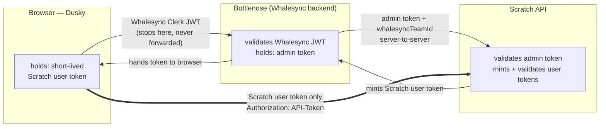
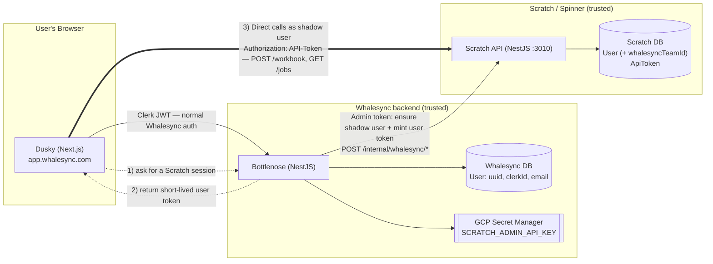
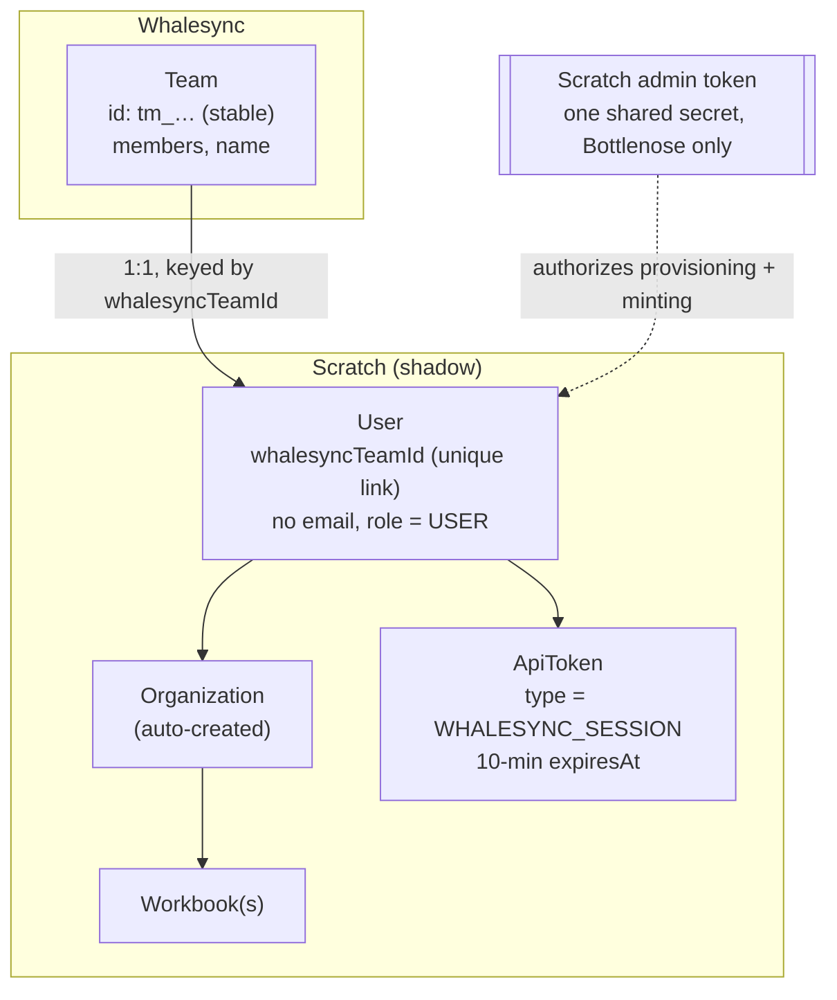
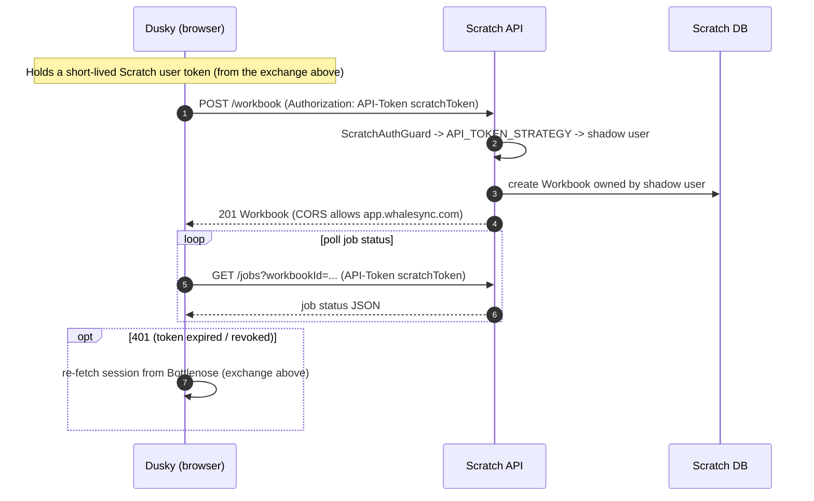
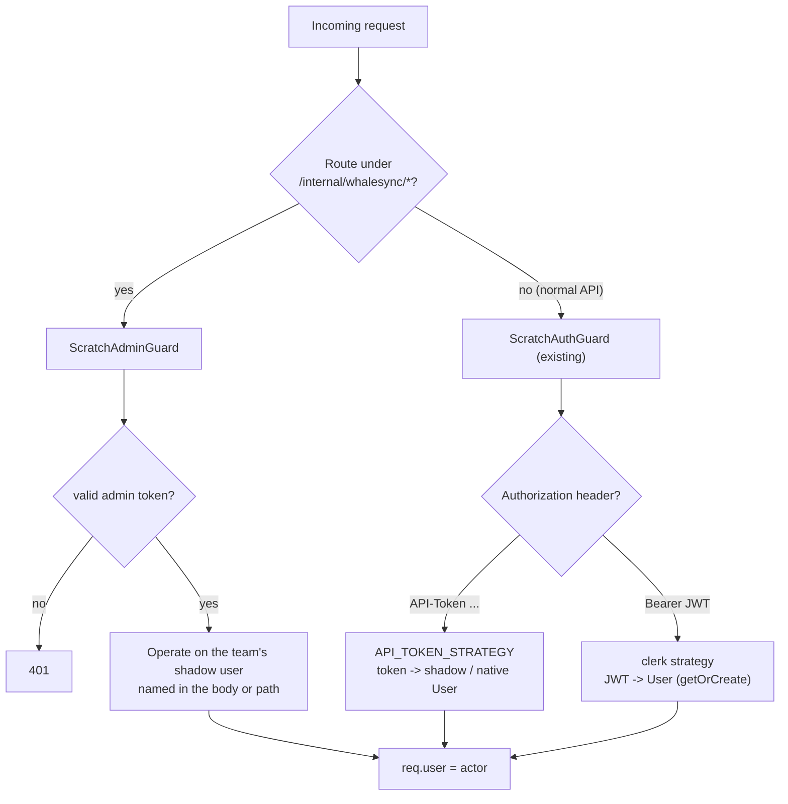

# Whalesync → Scratch: Direct API Access for Dusky

> **Status:** Draft (for refinement)
> **Author:** Chris Hoefgen
> **Created:** 2026-06-04
> **Linear:** [DEV-10325 — WS→Scratch Auth system](https://linear.app/whalesync/issue/DEV-10325/ws-scratch-auth-system)

## Problem

We want Whalesync users to drive Scratch directly from the Whalesync product. Concretely, the Whalesync UI (**Dusky**, a Next.js app at `app.whalesync.com`) should be able to create Scratch workbooks, read job status, and otherwise call the Scratch API **as the acting Whalesync user**, without that user ever signing up for or logging into Scratch separately.

To make this work, every Whalesync team gets a **shadow user** in the Scratch database (originally every Whalesync user did; see [A shadow user per Whalesync team](#a-shadow-user-per-whalesync-team-dev-13019)), and Scratch must be able to authorize requests that originate in the Whalesync product and resolve them to the correct shadow user.

### Hard constraint: Whalesync and Scratch use separate Clerk applications

Whalesync and Scratch each authenticate with **their own, separate Clerk application**, and they must stay separate for now. The implications drive the entire design:

- A Whalesync user's JWT is signed by Whalesync's Clerk app; a Scratch user's JWT is signed by Scratch's Clerk app. They have different signing keys, issuers, and audiences.
- Scratch's Clerk strategy validates against **Scratch's** Clerk keys, so a Whalesync JWT presented to Scratch fails signature / `iss` / `aud` validation. **A Whalesync JWT cannot authenticate to Scratch.**
- Therefore Dusky cannot simply forward its Whalesync session to Scratch. It must present a credential that **Scratch itself issued**.

## Goals

- Every Whalesync team maps 1:1 to a Scratch shadow user, created on demand.
- Dusky calls the Scratch API **directly** (browser → Scratch), authenticated as the shadow user.
- The Whalesync backend (**Bottlenose**) can call Scratch in two modes:
  - **User-scoped** — acting as a specific shadow user.
  - **Admin** — privileged operations like shadow-user creation and token minting.
- Reuse Scratch's existing per-user API-token auth; keep the two Clerk identity domains fully isolated.

## Non-goals (for v1)

- Sharing a Clerk tenant or any SSO/identity federation between the two products.
- Mapping Whalesync **teams/orgs** to shared Scratch organizations. A team gets one shadow user, which gets its own auto-created Scratch org; cross-user workbook sharing is out of scope for v1 (see [Decision status](#decision-status)).
- Proxying every Scratch call through Bottlenose (we explicitly want direct browser → Scratch; the proxy is noted only as an alternative).

## Core concept: swap the Whalesync JWT for a Scratch-native token

Dusky **never** sends its Whalesync JWT to Scratch. Instead it presents a short-lived **Scratch-issued API token** that was brokered to it through Bottlenose. The two Clerk JWTs never meet.

There are three credentials, and each is validated by exactly the one party that can validate it — none crosses a trust boundary it cannot be verified at:

| Credential               | Issued by                  | Presented to        | Validated by                         | Reaches Scratch?         |
| ------------------------ | -------------------------- | ------------------- | ------------------------------------ | ------------------------ |
| Whalesync Clerk JWT      | Whalesync's Clerk          | Bottlenose          | **Bottlenose** (Whalesync's Clerk)   | ❌ never                  |
| Scratch admin token      | Scratch (shared secret)    | Scratch `/internal/*` | **Scratch** `ScratchAdminGuard`    | server-to-server only    |
| Scratch user token (`ApiToken`) | **Scratch**, bound to shadow user | Scratch `/workbook`, `/jobs` | **Scratch** `API_TOKEN_STRATEGY` | ✅ the browser carries this |

The trust bridge is the **admin channel** (Bottlenose → Scratch), which is server-to-server and never sees the browser. Bottlenose is the only party that can validate the Whalesync identity, so it does that once, then vouches for the user to Scratch over the admin token. The output — a Scratch-native `ApiToken` already bound to the shadow user — is the only thing the browser ever presents to Scratch.



## Architecture: system context



The browser never holds the admin token. Bottlenose is the only thing that can provision or mint. Dusky talks to Scratch directly for the actual work; Bottlenose is just the broker that hands out a short-lived user token.

## Identity model: the shadow user

Key the shadow user on the **Whalesync team id** (`tm_…`): it is immutable, unlike a name or email, and unambiguous, unlike `clerkId` (which belongs to a different Clerk tenant). The v1 design keyed it on the Whalesync user UUID; [DEV-13019](https://linear.app/whalesync/issue/DEV-13019) moved it to the team (see [A shadow user per Whalesync team](#a-shadow-user-per-whalesync-team-dev-13019)). Scratch's `User` carries:

```prisma
model User {
  // ... existing fields ...
  clerkId         String? @unique   // existing column: real Clerk ID (user_…) for native users; synthetic "ws_<whalesyncTeamId>" for a team's shadow user
  whalesyncTeamId String? @unique   // the Whalesync team whose Live Exports this shadow user holds; null for native Scratch users
  whalesyncUserId String? @unique   // v1's link to a Whalesync person; no longer read or written, dropped in a follow-up MR
}

model ApiToken {
  // ... existing fields ...
  type String @default("USER")      // add a "WHALESYNC_SESSION" value for browser session tokens
}
```



- `whalesyncTeamId` is the idempotency key for provisioning and the link to the Whalesync team. Scratch keeps no record of the people in a team.
- **Synthetic Clerk ID.** Scratch's `User.clerkId` is `@unique` and is populated by the existing creation routine, so each shadow user is given a generated one — prefixed `ws_`, concretely `ws_<whalesyncTeamId>` — to differentiate it from a real Clerk ID (Clerk issues `user_…`). The prefix doubles as a discriminator: any server code that would otherwise call Clerk for a user can skip those whose `clerkId` starts with `ws_`, since they don't exist in Scratch's Clerk app, and a user with that prefix is a **pure shadow user**. Deriving it from the team id keeps it unique and idempotent. The existing routine stamps the same `clerkId` on the auto-created Organization.
- A `WHALESYNC_SESSION` token type lets these browser tokens get a short (10-minute) TTL, **bypass the API rate limiter**, and be told apart from a user's CLI/desktop tokens. v1 does **not** enforce `ApiToken.scopes`; the token type itself is the flag.
- Provisioning reuses the **same** path Scratch runs today on first Clerk login (`getOrCreateUserFromClerk` → create User + Organization + default Workbook in `spinner/server/src/users/users.service.ts`). The only difference is the trigger: an explicit admin call instead of a JWT side effect.
- 1 Whalesync team → 1 Scratch user → 1 Scratch org. Cross-user workbook sharing is out of scope for v1.

### A shadow user per Whalesync team (DEV-13019)

Whalesync moved everything a person owned to a team, and a team's Live Exports have to show for every member. So a
shadow user holds the Live Exports of one Whalesync **team**, keyed by a unique `User.whalesyncTeamId` (`tm_…`), and
every admin route names it by team. Scratch keeps no record of which person in a team created a Live Export or acted
in a session: everything about a Live Export belongs to its team. The rollout plan is
`docs/plans/2026-11-25-live-exports-by-team.md` in the whalesync repo.

One shadow user per team, rather than one per person in a shared organization, because Scratch lists workbooks
through per-user `WorkspacePermission` rows: a shadow user per person would need a row for every member on every Live
Export, kept current as people join and leave.

**A session is for a team.** `POST /internal/whalesync/sessions` finds the team's shadow user, or creates a pure
shadow user for it: clerkId `ws_<whalesyncTeamId>`, the team's `name` as its label, no email, and no Whalesync person
id. An existing shadow user is reused as it is; its name is not refreshed. Any member's session reaches the same
shadow user, so every member of a team with several members can open Live Export. Body keys the schema doesn't name
are stripped, not rejected: Bottlenose sends `whalesyncUserId`, `whalesyncUserIsTeamsOnlyMember`, and `email` until
its own change ships, and Scratch ignores them.

**A team's shadow user is never a real Scratch account.** A team has no email, so its shadow user is never matched to
a native Scratch account by email, in either direction: a native Clerk sign-up can't adopt it
(`getOrCreateUserFromClerk` adopts by email), and provisioning never adopts a Scratch user either. The lookup by
person and the adoption by email that came with it ([DEV-10331](https://linear.app/whalesync/issue/DEV-10331):
reuse the user linked to a `whalesyncUserId`, else link the native Scratch user that owned the person's email) are
gone. As a fail-safe, every admin route checks the user that holds the team id: when it isn't a pure shadow user (its
clerkId doesn't start with `ws_`, so it has a real Scratch login), the route answers 409 and logs an error, and never
hands out a session for it, sets its Live Export access, lists its workbooks, or deletes it.

**The real Scratch accounts that were teams' shadow users are gone.** Before this, some teams' shadow users were real
Scratch accounts: one adopted by email before teams, or a shadow user whose person signed in to Scratch before it got
its team (22 in production on 2026-11-26). The `whalesync-teams-off-real-accounts` code migration moved each one's
Live Exports to a new pure shadow user for its team, in an organization of its own, and unlinked the account. It has
run in production and test, which had none left as of 2026-11-27, so the migration and the special cases it needed
(the 409 for a teammate of a real account, and unlinking a real account on deprovision) have been removed.

**Shadow users that belong to no team are deprovisioned once.** Pure shadow users made for a person before teams and
never given a team can't be reached through the admin channel any more (about 16 in test, none in production). The
`whalesync-teamless-shadow-users-deprovision` code migration (Settings → Dev → Migrations, dry run supported) deletes
them through the same routine as a team's deprovision. It selects them by data, skips and reports any that isn't a
pure shadow user, holds a Live Export, or shares its organization with another member, and is idempotent.

**A failed Live Export run names its team.** The notification Scratch sends Whalesync
(`POST /internal/scratch/live-export-runs/finished`) always carries `whalesyncTeamId`, the team of the shadow user
that owns the workbook, and Whalesync emails that team. It never carries a person's id. A workbook whose user belongs
to no team is skipped and logged.

**`User.whalesyncUserId` is left over.** The server no longer reads or writes it, and PostHog's
`is_whalesync_shadow_user` keys on `whalesyncTeamId`. The column stays until a follow-up MR drops it, because a server
of the previous version still writes it during a deploy.

### Live Export access (DEV-12983)

Whalesync decides what a team's Live Exports may do, and Scratch carries it out. Scratch never reads a Whalesync
subscription. Whalesync works out each team's **Live Export access** from the team's plan and sends the whole of it,
on every session and whenever it changes (`PUT /internal/whalesync/teams/:whalesyncTeamId/live-export-access`):

```
{ paused: boolean, recordLimit: number | null, fastestCadence: 'daily' | 'hourly' | 'frequent' | null }
```

`null` means no limit. Scratch keeps the three values in the metadata of the organization's one `WHALESYNC_PLAN`
subscription row (`liveExportsPaused`, `liveExportRecordCountLimit`, and `liveExportCadence`), and acts on them only
for Live Export (`ws_export`) workbooks:

- **Paused:** `RoutineExecutorService.triggerRun` refuses every run before it is created. Run now answers 403 with
  `{ error: 'LIVE_EXPORT_PAUSED', message }`, and a scheduled run is skipped and logged, with no run row and no
  failure email. `LiveExportRecordLimitEnforcer` refuses publish and sync jobs started outside a run, so every other
  route that starts them is covered; a run that was already going finishes. Schedules are left as they are, so sending
  `paused: false` resumes them with nothing else to do.
- **Speed:** a scheduled run that comes sooner after the export's last scheduled run than `fastestCadence` allows (9,
  59, or 1,379 minutes) is skipped. A schedule that fits is never compared with past runs. So a downgrade slows
  existing exports without rewriting anyone's schedule, and an upgrade speeds them up again. Run now isn't limited.
- **Records:** the record cap (behind `SUBSCRIPTION_ENFORCEMENT_ENABLED`) fails sync and publish jobs while the team's
  Live Exports hold more than `recordLimit` records.

A team is paused only once Whalesync says so: with no `WHALESYNC_PLAN` row, or no stored value, its Live Exports run
with no limits. The row itself stays active with a ~100-year expiry and never lapses, so Scratch's own subscription
rules (`SubscriptionEnforcementService`, which turns off every schedule in a lapsed organization, and the data source
limit) never act on a shadow organization, and building a Live Export is never refused. Applying an access writes
nothing when it is already in place, and records an audit entry when the pause changes. The rules are in
`server/src/live-export-access/`.

A Whalesync backend from before this sends the old `subscription` payload instead (`{ status, whalesyncProductType,
liveExportRecordCountLimit, liveExportCadence, expiresAt }`), on a session and on `PATCH /internal/whalesync/subscription`.
Scratch maps it onto an access: paused unless `status` is `active`, with its record limit and cadence. Its product
type and expiry are ignored. Both go once every Whalesync environment sends `liveExportAccess`.

## The two Bottlenose → Scratch channels

| Channel              | Credential                       | Used for                                                                 | Auth on Scratch                         |
| -------------------- | -------------------------------- | ------------------------------------------------------------------------ | --------------------------------------- |
| **Admin**            | Single shared secret, Bottlenose-only | Ensure a team's shadow user and mint its tokens, set its Live Export access, list its Live Exports, deprovision | **new** `ScratchAdminGuard` |
| **User-scoped**      | A shadow user's `ApiToken`       | Any operation acting as that user (also what the browser carries)        | **existing** `API_TOKEN_STRATEGY`       |

The admin secret lives only in Bottlenose, loaded from GCP Secret Manager (the existing pattern in `whalesync/api/bottlenose/src/secrets/secrets.service.ts`). It is never exposed to the browser.

## Provisioning + token exchange (admin path)

```mermaid
sequenceDiagram
  autonumber
  participant D as Dusky (browser)
  participant B as Bottlenose
  participant S as Scratch API
  participant DB as Scratch DB

  Note over D,B: User already authenticated to Whalesync (Clerk JWT)
  D->>B: GET /rest/scratch/session  (Authorization: Bearer Whalesync-JWT)
  B->>B: Validate JWT against Whalesync's Clerk; work out the team the user is working in
  B->>S: POST /internal/whalesync/sessions<br/>X-Scratch-Admin-Token + {whalesyncTeamId, name}
  S->>S: ScratchAdminGuard validates admin token
  S->>DB: find User by whalesyncTeamId
  alt shadow user missing
    S->>DB: create User(whalesyncTeamId + synthetic ws_ clerkId, no email), Org, default Workbook
  end
  S->>DB: create 10-minute ApiToken (type = WHALESYNC_SESSION)
  S-->>B: { scratchUserId, apiToken, expiresAt }
  B->>B: cache token in Redis until near expiry
  B-->>D: { scratchToken, expiresAt }
```

### New Scratch internal endpoints (behind `ScratchAdminGuard`)

Mounted under an internal-only route prefix, ideally network/IP-restricted in addition to the shared secret. Every
route names a Whalesync team, and every one answers 409 (and logs an error) when the user holding that team id is not
a pure shadow user (see [A shadow user per Whalesync team](#a-shadow-user-per-whalesync-team-dev-13019)).

```
POST /internal/whalesync/sessions
  Header: X-Scratch-Admin-Token: <secret>
  Body:   { whalesyncTeamId: string, name?: string, liveExportAccess?: { paused, recordLimit, fastestCadence },
            subscription?: { status, … } }
  200:    { scratchUserId, apiToken, expiresAt }   // apiToken TTL = 10 minutes; expiresAt is a UTC ISO-8601 timestamp
  409:    the user holding the team id is a real Scratch account (fail-safe)
  Behavior: ensure-team-shadow-user-then-mint, idempotent on whalesyncTeamId. A missing shadow user
            is created as a pure one: clerkId ws_<whalesyncTeamId>, name as its label, no email.
            Applies the team's Live Export access (liveExportAccess, or the old subscription mapped onto
            one). With neither, an existing plan is left alone, and a new one runs with no limits.
            Unknown body keys are stripped, not rejected.
            Folds provisioning + token minting into one round-trip.

PUT /internal/whalesync/teams/:whalesyncTeamId/live-export-access
  Body:   { paused: boolean, recordLimit: number | null, fastestCadence: 'daily' | 'hourly' | 'frequent' | null }
  200:    { scratchUserId, updated }
          // { scratchUserId: null, updated: false } when the team has no shadow user; nothing is created
  409:    the fail-safe
  Behavior: sets the team's Live Export access (see "Live Export access" above). Idempotent: a
            repeat writes nothing and answers updated: false.

PATCH /internal/whalesync/subscription
  Body:   { whalesyncTeamId: string, subscription: { status, … } }
  200:    { scratchUserId, updated, planType }
          // { scratchUserId: null, updated: false, planType: null } when the team has no shadow user
  409:    the fail-safe
  Behavior: the old way to set the team's Live Export access: the payload is mapped onto one
            (paused unless status is active) and applied as the PUT above applies it. The plan never
            lapses. Removed once every Whalesync environment sends liveExportAccess.

GET /internal/whalesync/teams/:whalesyncTeamId/live-exports
  200:    { liveExports: [{ id, name, createdAt, updatedAt }] }   // newest first
  Behavior: lists the team's Live Export workbooks, skipping those pending deletion, for
            Whalesync's admin dev tools. Read-only: a team with no shadow user gets an empty
            list and none is created.

DELETE /internal/whalesync/teams/:whalesyncTeamId
  204, idempotent: a team with no shadow user is a no-op.
  Deletes the team's pure shadow user (with its tokens) and, when it is the sole member,
  its organization and every workbook that organization owns, through
  WorkbookService.executeHardDeleteWorkbook so the repos/jobs/tables are cleaned up (per
  the deletion rule in CLAUDE.md).
```

Removed with DEV-13019, as Scratch stopped knowing Whalesync people: every route by person
(`POST /internal/whalesync/users`, `DELETE /internal/whalesync/users/:whalesyncUserId`, and its `/sessions`,
`/subscription`, and `/live-exports` routes), the team-link backfill (`GET /internal/whalesync/team-links/pending` and
`POST /internal/whalesync/team-links`), and the `?whalesyncUserId=` query parameter on the team routes.

Minting creates a `WHALESYNC_SESSION` `ApiToken` row for the shadow user (`mintWhalesyncSessionToken` in
`spinner/server/src/users/users.service.ts`); it records no Whalesync person.

### New Bottlenose endpoint (for Dusky)

```
GET /rest/scratch/session
  Auth: Whalesync Clerk JWT (existing JwtAuthGuard)
  200:  { scratchToken, expiresAt }            // 10-minute token; expiresAt is UTC (ISO-8601); Dusky refreshes before expiry
  Behavior: validate the Whalesync user, call POST /internal/whalesync/sessions
            with the admin token, cache per Whalesync user until near expiry, return.
```

**Scratch base URL (per environment).** Not returned in the session response. Bottlenose resolves which Scratch to call from an environment variable sourced from a GCP secret; Dusky's Scratch base URL is baked in at Docker build time (e.g. `NEXT_PUBLIC_SCRATCH_API_URL`), the same way its Bottlenose target is configured today.

## Runtime: Dusky → Scratch directly



From Scratch's perspective this is **already a supported request shape** — `API_TOKEN_STRATEGY` resolving an `Authorization: API-Token <token>` header is exactly how the CLI and desktop authenticate today (`spinner/server/src/auth/api-token.strategy.ts`). `POST /workbook` and `GET /jobs` are unchanged; they derive the owner via `userToActor(req.user)`, and the shadow user simply *is* `req.user`. Job-status polling can be frequent, so `WHALESYNC_SESSION` tokens **bypass** `ApiRateLimitGuard` (revisit if abuse becomes a concern).

## How a request resolves inside Scratch



## Browser mechanics of "directly"

Four concrete requirements, none of which involve Clerk:

1. **CORS on Scratch.** The call is cross-origin (`app.whalesync.com` → Scratch's domain). Scratch must reflect the specific Whalesync origins (prod / test / staging) and allow the `Authorization` header on preflight. This likely is not configured today and is a required addition.

2. **Where the token lives in the browser** — pick the exposure tradeoff:

   |                  | In-memory bearer (default)                                   | httpOnly cookie (hardened)                                                        |
   | ---------------- | ------------------------------------------------------------ | -------------------------------------------------------------------------------- |
   | How              | Dusky keeps `scratchToken` in JS memory; sends `Authorization: API-Token …` | Scratch sets `Secure; HttpOnly; SameSite=None` cookie on its domain; browser sends it with `credentials: 'include'` |
   | Scratch changes  | none (reuses `API_TOKEN_STRATEGY`)                           | new cookie-auth path + CSRF protection + a `/session/establish` endpoint to set the cookie |
   | XSS exposure     | token reachable by JS — mitigated by the 10-minute TTL       | not reachable by JS                                                              |
   | Headwind         | —                                                            | third-party-cookie deprecation; needs `Partitioned` / CHIPS                      |

   **Recommendation for v1:** in-memory bearer + the 10-minute TTL. It reuses the existing token strategy with zero Scratch auth changes; short expiry is what makes a browser-held token acceptable. Move to the cookie model only if XSS exfiltration of even a short-lived token is unacceptable.

3. **Refresh.** Session tokens live **10 minutes**. Dusky proactively refreshes shortly before expiry and reactively on a `401` by re-calling `GET /rest/scratch/session`. Bottlenose caches the token per Whalesync user until near expiry, so this is not a round-trip on every page load.

4. **Revocation.** These are real `ApiToken` rows (`type = WHALESYNC_SESSION`), so each one stops working after its 10 minutes, and all of them go with the shadow user when the team is deprovisioned. There is no per-person revocation: a team's members share one shadow user, and Scratch does not record which person a token was minted for.

## Why this is safe

The security crux: **Scratch trusts no identity claim that arrives via the browser.** A browser cannot tell Scratch "I am Whalesync team X" — it can only present a token Scratch already bound to a shadow user during the server-to-server exchange. The `whalesyncTeamId → shadow user` mapping is asserted **only** over the admin channel, authenticated by the admin secret, after Bottlenose has validated the real Whalesync JWT.

Each credential is validated by exactly the party that issued or can verify it; none crosses a boundary it cannot be verified at. Keeping the Clerk apps separate is therefore not a problem the design fights — it is the reason the boundary stays clean. The only thing we give up versus a shared-Clerk world is statelessness: Scratch cannot lazily auto-provision from a JWT, so provisioning becomes an explicit admin call instead of a first-request side effect. That is a worthwhile trade for keeping the identity domains isolated.

### Admin-token hardening

- Store only in GCP Secret Manager; never in the browser, never in client bundles.
- Constant-time comparison in `ScratchAdminGuard`.
- Restrict `/internal/*` to internal network / IP allowlist so a leaked secret alone is not sufficient.
- Support rotation (accept current + previous secret during a rotation window).

## What changes, by repo

### Scratch (`spinner/server`) — additive

- **Schema:** add `whalesyncTeamId String? @unique` to `User` (v1's `whalesyncUserId` column is no longer used and is dropped in a follow-up MR); add a `WHALESYNC_SESSION` value to `ApiToken.type` (`spinner/server/prisma/schema.prisma`).
- **`ScratchAdminGuard` + admin strategy:** validate `X-Scratch-Admin-Token` against `SCRATCH_ADMIN_API_KEY`, constant-time; lock to internal network.
- **`spinner/server/src/internal/whalesync.controller.ts`:** the endpoints above, reusing existing provisioning + token services. Shadow-user creation generates a synthetic `clerkId` of `ws_<whalesyncTeamId>` to satisfy the `@unique` `clerkId` column and mark the user as Whalesync-provisioned.
- **CORS:** allow `app.whalesync.com` (+ test/staging) origins with `Authorization` on preflight.
- **Rate limiting:** `ApiRateLimitGuard` skips requests authenticated by a `WHALESYNC_SESSION` token, so Dusky's job-status polling isn't throttled.
- **Token TTL:** mint `WHALESYNC_SESSION` tokens with a 10-minute expiry.
- **Expired-token cleanup (cron):** add a scheduled job that periodically deletes expired rows from the `ApiToken` table (`expiresAt < now()`). With 10-minute `WHALESYNC_SESSION` tokens minted on every session, the table would otherwise grow unbounded.
- The existing `API_TOKEN_STRATEGY` and `ScratchAuthGuard` need no change for the user-token path.

### Bottlenose (`whalesync/api/bottlenose`)

- **`ScratchApiClient` service** using the existing `WsHttpService` / axios pattern, holding the admin token **and the Scratch base URL** from config (admin token via `SecretsService` / GCP secret; base URL via env var, per environment).
- **`GET /rest/scratch/session`** (Clerk-JWT-guarded) → ensure shadow user + return a 10-minute token; serve from the token cache until near expiry.
- **Token cache (Redis):** cache issued session tokens in Redis, keyed by Whalesync user ID with a logical prefix (e.g. `scratch:session:<whalesyncUserId>`), with a TTL at or just under the token's 10-minute expiry. Serving from cache avoids an admin round-trip to Scratch on every page load.
- **Lifecycle:** on user archive/delete → admin deprovision call. (Eager provisioning on signup is optional; lazy-on-first-session is simpler.)

### Dusky (`whalesync/dusky`)

- A `scratchAxios` instance pointed at the **build-time-configured** Scratch base URL (baked into the Docker image, e.g. `NEXT_PUBLIC_SCRATCH_API_URL`), with the token seeded from `/rest/scratch/session` and refreshed before expiry / on `401` (mirrors the existing `authAxios` setup in `whalesync/dusky/lib/client/v1/methods.ts`).
- Hooks: `useScratchSession()`, then `createWorkbook()`, `useJobStatus()` calling Scratch directly.

## Alternative considered: proxy through Bottlenose

If we did not want any Scratch token in the browser at all, Bottlenose could proxy every Scratch call (browser → Bottlenose → Scratch, server-side user token). This avoids CORS and keeps tokens off the client, but it is explicitly **not** "directly": Bottlenose lands in every request's hot path and must re-expose Scratch's API surface. Given the goal of direct browser ↔ Scratch, the brokered short-lived token is the chosen shape. The proxy remains a fallback if browser-token exposure proves unacceptable and the httpOnly-cookie variant is not pursued.

## Decision status

| Decision                                   | Status      | Notes                                                                                                       |
| ------------------------------------------ | ----------- | ----------------------------------------------------------------------------------------------------------- |
| Clerk topology                             | ✅ Resolved | Separate Clerk apps; must stay separate. Drives the whole design.                                            |
| Direct browser → Scratch (vs proxy)        | ✅ Resolved | Direct, via a brokered Scratch-native token.                                                                 |
| Shadow-user mapping key                    | ✅ Resolved | Whalesync team id (`whalesyncTeamId`, unique on Scratch `User`). Was the Whalesync user UUID before [DEV-13019](https://linear.app/whalesync/issue/DEV-13019). |
| Shadow-user Clerk ID                        | ✅ Resolved | Synthetic `ws_<whalesyncTeamId>` (native users get Clerk's `user_…`); satisfies the `@unique` `clerkId`.     |
| Org model                                  | ✅ Resolved | Each team's shadow user gets its own auto-created Scratch org. Cross-user workbook sharing is out of scope for v1. |
| Whalesync teams                            | ✅ Resolved | One shadow user per Whalesync team, keyed by `whalesyncTeamId` ([DEV-13019](https://linear.app/whalesync/issue/DEV-13019)). See [A shadow user per Whalesync team](#a-shadow-user-per-whalesync-team-dev-13019). |
| Token TTL                                  | ✅ Resolved | **10 minutes.** Dusky refreshes before expiry (and on `401`).                                                |
| Token scopes                               | ✅ Resolved | `ApiToken.scopes` not enforced in v1; the `WHALESYNC_SESSION` token type is the flag.                        |
| Rate limiting                              | ✅ Resolved | `WHALESYNC_SESSION` tokens bypass `ApiRateLimitGuard`.                                                       |
| Scratch base URL (per environment)         | ✅ Resolved | Bottlenose: env var sourced from a GCP secret. Dusky: baked in at Docker build time.                         |
| Native + shadow user with the same email   | ✅ Resolved | **Never matched.** A team's shadow user has no email, so neither side adopts the other. Replaced the adoption by email of [DEV-10331](https://linear.app/whalesync/issue/DEV-10331), which itself replaced a `ws:` email prefix. See [A shadow user per Whalesync team](#a-shadow-user-per-whalesync-team-dev-13019). |
| Token storage in browser                   | 🔶 Open     | In-memory bearer (leaning, given the 10-min TTL) vs httpOnly cookie.                                         |
| Admin-token transport & rotation           | 🔶 Open     | `X-Scratch-Admin-Token` header proposed; confirm + define rotation window.                                   |
| Eager vs lazy shadow-user provisioning     | 🔶 Open     | Lazy-on-first-session proposed.                                                                              |

## Open questions

- **Token storage in the browser.** In-memory bearer (leaning, given the 10-minute TTL) vs an httpOnly cookie. Decide before building the Dusky client.
- **Admin-token transport & rotation.** Confirm `X-Scratch-Admin-Token` as the header, and define the rotation window (accept current + previous secret during rotation).
- **Eager vs lazy provisioning.** Lazy-on-first-session is proposed; confirm we don't need to pre-provision a shadow user at Whalesync signup (e.g. for backend-initiated workbook creation before the user ever opens the Scratch UI).

## Resolved questions

Decisions captured from review (folded into the design above and the [Decision status](#decision-status) table):

- **Token TTL → 10 minutes.** Dusky refreshes before expiry and on `401`; Bottlenose caches per Whalesync user.
- **Token scopes → not enforced in v1.** `ApiToken.scopes` is left unenforced; the `WHALESYNC_SESSION` token type is the flag that drives TTL and rate-limit bypass.
- **Scratch base URL → configuration, not response.** Bottlenose reads it from an env var sourced from a GCP secret; Dusky bakes it in at Docker build time.
- **Email collisions → none (twice superseded).** The original v1 decision kept a native Scratch user and a same-email Whalesync user as two distinct accounts (via a `ws:` email prefix). [DEV-10331](https://linear.app/whalesync/issue/DEV-10331) replaced this by adopting the existing user that owned the email. [DEV-13019](https://linear.app/whalesync/issue/DEV-13019) removed that: a team's shadow user has no email, so it is never matched to a Scratch account. See [A shadow user per Whalesync team](#a-shadow-user-per-whalesync-team-dev-13019).
- **Rate limiting → bypass for session tokens.** `WHALESYNC_SESSION` tokens are exempt from `ApiRateLimitGuard` so Dusky's polling isn't throttled.
- **Org/team → shadow org per team.** Each team's shadow user gets its own auto-created Scratch org; cross-user workbook sharing is out of scope for the initial release.
- **Shadow-user Clerk ID → synthetic `ws_` value.** Each shadow user gets `clerkId = ws_<whalesyncTeamId>` to satisfy the `@unique` `clerkId` column and to distinguish it from a real Clerk ID; server code can skip Clerk calls for `ws_`-prefixed users.

## References

### Scratch (spinner)

- Auth guard chain: `spinner/server/src/auth/scratch-auth.guard.ts` (`AuthGuard(['API_TOKEN_STRATEGY', 'clerk'])`)
- API token strategy: `spinner/server/src/auth/api-token.strategy.ts` (`Authorization: API-Token <token>`)
- Clerk strategy + provisioning: `spinner/server/src/auth/clerk.strategy.ts`, `spinner/server/src/users/users.service.ts` (`getOrCreateUserFromClerk`, `getOrCreateShadowUserForWhalesyncTeam`, `mintWhalesyncSessionToken`)
- User / ApiToken models: `spinner/server/prisma/schema.prisma`
- Workbook + job endpoints: `spinner/server/src/workbook/workbook.controller.ts`, `spinner/server/src/job/job.controller.ts`
- Permissions: `spinner/server/src/auth/permissions.ts`

### Whalesync

- Frontend HTTP client / auth: `whalesync/dusky/lib/client/v1/methods.ts`, `whalesync/dusky/components/contexts/clerk-auth.tsx`
- Backend JWT auth: `whalesync/api/bottlenose/src/auth/jwt.clerk.strategy.ts`, `whalesync/api/bottlenose/src/auth/jwt-auth.guard.ts`
- Secrets + outbound HTTP: `whalesync/api/bottlenose/src/secrets/secrets.service.ts`, `whalesync/api/bottlenose/src/http/ws-http.service.ts`
- User model (uuid): `whalesync/api/bottlenose/prisma/schema.prisma`
